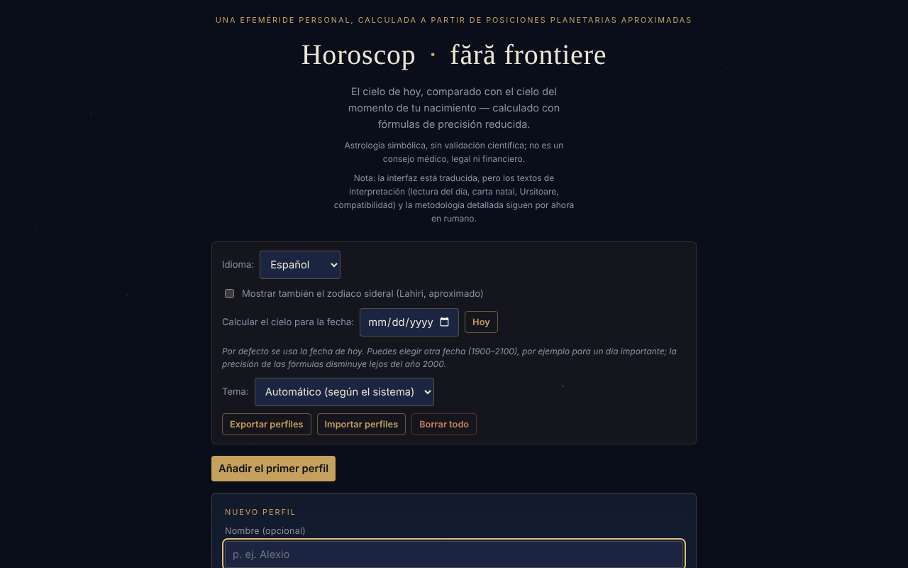

# Horoscop · fără frontiere

[English](README.md) · [Română](README.ro.md) · [Français](README.fr.md) · [Italiano](README.it.md) · **Español** · [Português](README.pt.md) · [Deutsch](README.de.md) · [Magyar](README.hu.md)

**Versión:** 1.3.8 · **Última actualización:** 2026-10-23

Idiomas de la interfaz: **Română, English, Français, Italiano, Español, Português (PT), Deutsch, Magyar**

Una efeméride personal, calculada localmente a partir de posiciones planetarias aproximadas (fórmulas keplerianas de precisión reducida): el cielo de hoy, comparado con el cielo del momento de tu nacimiento.

**En línea:** https://chiuta.github.io/HoroScop/

## Qué es

Horoscop es una aplicación en un solo archivo HTML que calcula en el navegador las posiciones del Sol, la Luna y los ocho planetas (elementos orbitales keplerianos, fórmulas de precisión reducida de tipo Schlyter / Meeus), las compara con la carta natal de un perfil y compone una «lectura» diaria. La aplicación aclara en el texto que la astrología se trata de forma simbólica y que no estima riesgos de salud ni de mortalidad.

## Funciones

- Perfiles múltiples (nombre opcional, fecha, hora y huso horario UTC±, lugar de nacimiento con latitud/longitud para el ascendente): «Añadir», «Editar», «Duplicar», «Eliminar».
- La lectura del día por secciones: Panorama, Alma & relaciones, Trabajo & dinero, Cuerpo & energía, Consejo del día; «Copiar la lectura de hoy».
- «El cielo de hoy», «La semana que viene» (el aspecto más fuerte por día), elementos de hoy, retrógrados, Luna sin curso, posibles eclipses, cazimi / combusto.
- La carta natal, la estructura de la carta, los aspectos natales significativos, la rosa de aspectos, un orrery natal 3D (rotación arrastrando).
- Revoluciones solares (desde el nacimiento hasta hoy y proyección hacia delante), retornos de Saturno / Júpiter / Luna.
- Compatibilidad (sinastría) simplificada entre dos perfiles.
- «Música de las esferas»: cada planeta natal se convierte en un tono («▶ Tocar tu carta» / «■ Detener»).
- «Retrato cósmico»: un vídeo de unos 6 segundos generado localmente, descargable como `portret-cosmic.webm`.
- Opción para el zodiaco sideral (Lahiri, aproximado).
- «Calcular el cielo para la fecha»: eliges otra fecha (1900–2100, las 12:00 hora local) y todas las secciones (el cielo, los aspectos, la semana, la lectura, la copia) se calculan para ese día; «Hoy» vuelve a la fecha actual. La fecha elegida no se conserva entre sesiones.
- Tema: automático (según la preferencia del sistema), oscuro o claro; la elección se conserva localmente.
- Sección «Cómo se calcula esto» con la precisión estimada y los límites (no se calculan las casas astrológicas, solo el ascendente).

## Novedades (1.1.0)

La tarjeta plegable **«Efemérides locales (FFF.ephem)»**, al final de la página, calcula localmente (sin red), para un lugar y para la fecha elegida en la aplicación («Calcular el cielo para la fecha»; hoy por defecto):

- **Sol:** salida, paso por el meridiano (con la altitud máxima), puesta, duración del día y crepúsculos civil, náutico, astronómico.
- **Luna:** fase, iluminación, edad, distancia, salida/puesta y las cuatro fases siguientes (luna nueva, cuarto creciente, luna llena, cuarto menguante).
- **Posiciones** del Sol, la Luna y los ocho planetas (+ Plutón): longitud eclíptica con signo, altitud/acimut (con refracción), salida/puesta, magnitud, elongación.
- **La columna «Δ»**: la diferencia, en minutos de arco, entre la longitud del modelo simple de la aplicación (elementos keplerianos, el que alimenta las lecturas) y la de `FFF.ephem`. En 4 fechas de prueba las diferencias fueron: Sol ≤ 0,5′, planetas ≤ 8′ (los mayores: Plutón, Urano), Luna hasta ≈ 20′. Las cifras muestran cuánto puede equivocarse el modelo simple; las lecturas y los aspectos **no** se modificaron.
- El lugar: lat/lon, nombre de la lista de ciudades de la aplicación, perfil activo (lugar de nacimiento) o **GPS con consentimiento en dos pasos** (confirmación en la página, luego una sola petición; no se guarda). El huso horario se rellena con el del navegador y se puede editar (nombre IANA).
- La precisión declarada aparece en la tarjeta (sección «Precisión») y más abajo.

La tarjeta está solo en rumano (los textos de interpretación no están traducidos; el resto de la aplicación está disponible en 8 idiomas), y se oculta al imprimir.

## Manual de uso

1. Pulsa «Añadir el primer perfil» (o «Añadir»).
2. Rellena la fecha de nacimiento; opcionalmente el nombre, la hora, el huso horario UTC± (Rumanía: +2 en invierno, +3 en verano) y la latitud/longitud del lugar. Sin hora, el ascendente no se puede calcular.
3. Pulsa «Guardar el perfil» (o «Cancelar»).
4. Lee las secciones del día; «↻ Actualizar ahora» recalcula el cielo.
5. Marca la opción del zodiaco sideral si lo deseas; desde «Calcular el cielo para la fecha» puedes ver el cielo en otro día; desde «Tema» eliges el aspecto.
6. Para la música pulsa «▶ Tocar tu carta»; para el vídeo «🎬 Generar el retrato», y luego descarga el archivo.
7. «Exportar perfiles» guarda los perfiles en un archivo; «Importar perfiles» los vuelve a cargar; «Borrar todo» los elimina. La tecla Escape cierra el formulario de perfil (si hay otros perfiles).

## Privacidad y red

- Local: los perfiles se guardan en `localStorage` (`horoscopFF_profiles_v1`, el perfil activo `horoscopFF_active_v1`, la opción sideral `horoscopFF_sidereal_v1`, el tema `horoscopFF_theme_v1`). Si el almacenamiento no está disponible (modo privado), la aplicación muestra una advertencia y los perfiles no se conservan sin exportar.
- Red: en el código verificado no hay llamadas `fetch`, scripts ni recursos externos; los cálculos se hacen en el navegador.
- La interfaz tiene 8 idiomas (RO, EN, FR, IT, ES, PT, DE, HU); los textos largos de interpretación permanecen en rumano. Las traducciones automáticas fr/it/es/pt/hu/de (interfaz y kit) no están verificadas por hablantes nativos.

- 1.1.0: la **geolocalización** (`navigator.geolocation`) se usa solo si pulsas «Usar mi ubicación (GPS)» en la tarjeta de efemérides y confirmas en la página. No hay nuevas peticiones de red y no se guarda nada nuevo en `localStorage` (la tarjeta no tiene estado persistente). El kit `fff-kit` (`core`, `label`, `bundle`, `ephem`) añade el botón de transparencia y el índice `fff.horoscop.__keys` de las claves ya existentes.
## Advertencia

Contenido informativo, simbólico y de entretenimiento; no sustituye el consejo médico, jurídico o financiero. La astrología no tiene validación científica: las posiciones de los planetas son cálculos astronómicos (de precisión reducida, fórmulas de tipo Schlyter / Meeus), pero las interpretaciones (las «lecturas») son tradición cultural, no predicciones validadas. La misma nota aparece en el pie de página de la aplicación.

## Límites (las funciones nuevas)

- **Efemérides locales — precisión.** Frente al modelo físico de referencia (JPL DE421/DE423), las posiciones aparentes del Sol y los planetas difieren en ≤ 3″ (Neptuno ≤ 5″, Plutón ≤ 7″), las de la Luna en ≤ 1,5″; la salida/puesta del Sol ≤ 6 s, las de la Luna ≤ 25 s; las fases ≤ 30 s. Frente a pyephem 4.2.1 (prueba en `tests/`): salida/puesta ≤ 0,5 s, fases ≤ 6 s, alt/az ≤ 0,003°. Las horas se muestran redondeadas al minuto. **En la realidad** la salida/puesta difiere en minutos por la refracción real, el relieve y la altitud (no modelados), y ΔT es incierto en unos ±1 s en 2027. Las magnitudes son orientativas. No es adecuado para la navegación ni para observaciones astrométricas.
- El resto de la aplicación (lecturas, aspectos, cartas natales) sigue usando el modelo simple de precisión reducida; las nuevas efemérides no lo sustituyen. Las casas astrológicas no se calculan con `FFF.ephem`.

## Pruebas

`node tests/fff-r8.test.mjs` (Playwright desde `/opt/node-tools`, Chromium local, red bloqueada; `tests/_lib.mjs` contiene las utilidades comunes). Los valores de referencia están en `tests/ref-c3a.json`: los instantes de salida/puesta/paso (Sol, Luna; 5 lugares × 4 fechas), 56 instantes de fase y 54 posiciones alt/az, calculados de forma independiente con **pyephem 4.2.1** (usado solo sin conexión para generar los números; no forma parte de la aplicación). Cada prueba tiene su umbral escrito en el código; la prueba de accesibilidad (axe-core, `bypassCSP`) se ejecuta también en diálogos/paneles abiertos, a 1280×800 y 360×740.

## Uso local / sin conexión

Descarga `index.html` y ábrelo en un navegador; en el código verificado no necesita internet.

## Licencia

MIT — consulta el archivo `LICENSE`. © 2026 Alexandru-Ionuț Chiuță (Alexio). Las eventuales bibliotecas de terceros incluidas en el archivo conservan sus propias licencias.

Licencia: MIT (consulta el archivo LICENSE). Contacto: alexio@trom.tf

La misma declaración aparece en la cabecera HTML y en el pie de página de la aplicación. El texto de la licencia está en el archivo LICENSE.

## Historial / Changelog

### 1.3.7 — 2026-10-22

fff-kit 1.1.4: áreas táctiles y texto mínimo.

### 1.3.6 — 2026-10-22

fff-kit 1.1.2: PBKDF2 con 600.000 iteraciones, protección anti-clickjacking.

### 1.3.5 — 2026-10-22
- Los cuadros confirm()/prompt() del navegador sustituidos por diálogos propios traducidos a los 8 idiomas (borrado del perfil, borrado de todos los datos (dos pasos), copia manual); casilla del zodiaco sideral de 24 px; etiqueta «eyebrow» a 12 px.

### 1.3.4 — 2026-10-22
- Footer: removed duplicated license and disclaimer lines (Romanian).

### 1.3.3 — 2026-10-22
- Corrección de traducción: la descripción (y el nombre) del panel de transparencia siguen ahora el idioma de la interfaz. El aria-label del rosetón de aspectos está traducido y las líneas del pie de página que seguían en inglés en la interfaz rumana ahora están en rumano.

### 1.3.2 — 2026-10-22
- Corrección de traducción: el estado «ningún perfil guardado» se actualiza al instante al cambiar de idioma con el formulario de perfil abierto; el README rumano ya no contiene líneas en inglés.

### 19 de octubre de 2026 (v1.2.0)
- Nuevo: «↗ El cielo de tu nacimiento, en TerRa» (solo con hora y lugar); advertencia de historial; lugar redondeado a ~1 km; el nombre no se envía.

### 1.1.0 — 2026-10-14
- Nuevo: la tarjeta «Efemérides locales (FFF.ephem)» (salida/puesta/paso, crepúsculos, fases de la Luna, posiciones alt/az, columna Δ frente al modelo simple, GPS con consentimiento en dos pasos, precisión declarada); el kit `fff-kit` (`core`, `label`, `bundle`, `ephem`); `tests/fff-r8.test.mjs` (47 comprobaciones, incluido axe en los temas claro y oscuro, a 1280×800 y 360×740). Comparación antes/después a 1280×800: la página inicial es idéntica píxel a píxel (la tarjeta está cerrada por defecto), por lo que la captura de pantalla no cambió.

- 1.0.0 — 2026-10-12: la versión y la fecha de la última actualización se muestran en la aplicación (primera versión numerada; en el pie de página, en lugar de la antigua mención «actualizado el 11 de octubre de 2026»).

Ronda 7:
- **Verificación numérica documentada** (las fórmulas no se modificaron): el Sol el 13.10.1992 0h TD → 199,902° frente a 199,906° (Meeus, *Astronomical Algorithms*, ej. 25.a, método preciso, valor reconfirmado mediante pymeeus); la Luna el 12.04.1992 0h TD → 133,221° frente a 133,163° (ej. 47.a; diferencia 0,06°); el GMST el 10.04.1987 0h UT coincide con el ejemplo 12.a de Meeus (197,6932°); el equinoccio del 20.03.2026, 14:46 UTC → longitud solar 0,004°. El ascendente se comparó en 60 combinaciones aleatorias (años 1900–2099, latitudes ±70°, cualquier longitud) con un método numérico independiente — diferencia máxima inferior a 0,03°. El resumen aparece en la sección «Cómo se calcula esto». Los instantes se tratan como UTC (sin ΔT ≈ 1 minuto).
- Hash CSP recalculado; axe-core = 0 violaciones a 1280 y 360 px.

Ronda 6:
- Nuevo: «Calcular el cielo para la fecha» (1900–2100) y la elección del tema (automático / oscuro / claro, con paleta clara y compatibilidad con `prefers-color-scheme`). Los textos «hoy» se adaptan cuando se elige otra fecha. Hash CSP recalculado; captura de pantalla actualizada.
- Sinastría: mientras no se elige ningún perfil, la tarjeta muestra ahora «Elige un perfil de la lista para ver la compatibilidad.», en lugar de quedar vacía.
- Accesibilidad: el contenido de la página está ahora en un `<main>` (antes solo existía cuando el gráfico era visible); las dos listas desplazables de revoluciones solares tienen etiquetas distintas; axe-core = 0 violaciones, con y sin perfil, a 1280 y 360 px.
- La política CSP vincula ahora el script mediante hash (antes `'unsafe-inline'`).
- Los cálculos astronómicos son dinámicos (fecha actual); las fórmulas no se modificaron.

## Autor

Alexio — Alexandru-Ionuț Chiuță, contacto: alexio@trom.tf

## Resumen

Horoscop · fără frontiere es una efeméride personal en rumano, en un solo archivo: calcula posiciones planetarias en el navegador, compara el cielo de hoy con una carta natal y muestra lecturas diarias, aspectos, revoluciones solares, sinastría, un orrery natal 3D, música de tonos planetarios y un retrato WebM descargable. Los perfiles residen en localStorage con exportación/importación JSON. No se encontraron peticiones de red en el código. Licencia: MIT (consulta el archivo LICENSE) (contacto: alexio@trom.tf).

## Auditoría

Auditoría: 2026-10-10 (ronda 2, 2026-10-11: el eslogan «comparado exactamente» / «posiciones reales» reformulado por coherencia con la sección de metodología — precisión reducida, el signo puede diferir en un día en las cúspides) — verificado: 0 errores JS, sin peticiones de red (CSP `default-src 'none'; connect-src 'none'`), el nombre del perfil no produce XSS (probado con marcado en el nombre y el lugar). Corregidos el contraste del pie de página, la lista desplazable de revoluciones solares (ahora accesible con teclado) y se añadió la advertencia anterior.

Ronda 3 (2026-10-11): declaración explícita de licencia que no estaba declarada (cabecera, pie de página, README) y nota de advertencia astrológica visible bajo el título, en RO y EN.
