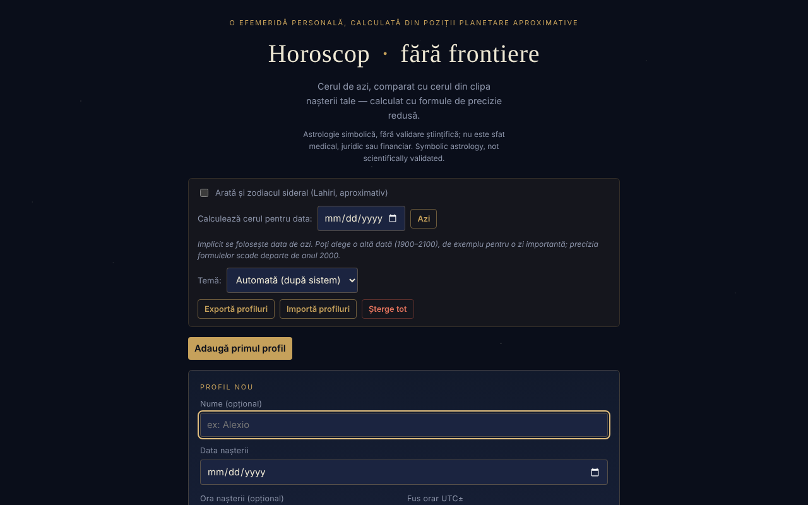

# Horoscop · fără frontiere

[English](README.md) · [Română](README.ro.md) · **Français** · [Italiano](README.it.md) · [Español](README.es.md) · [Português](README.pt.md) · [Deutsch](README.de.md) · [Magyar](README.hu.md)

**Version :** 1.2.0 · **Dernière mise à jour :** 2026-10-19

Une éphéméride personnelle, calculée localement à partir de positions planétaires approchées (formules képlériennes de précision réduite) : le ciel d'aujourd'hui, comparé au ciel du moment de votre naissance.

**En ligne :** https://chiuta.github.io/HoroScop/

## De quoi s'agit-il

Horoscop est une application en un seul fichier HTML qui calcule dans le navigateur les positions du Soleil, de la Lune et des huit planètes (éléments orbitaux képlériens, formules de précision réduite de type Schlyter / Meeus), les compare au thème natal d'un profil et compose une « lecture » quotidienne. L'application précise dans le texte que l'astrologie est traitée de façon symbolique et qu'elle n'estime ni risques de santé ni risques de mortalité.

## Fonctionnalités

- Profils multiples (nom facultatif, date, heure et fuseau horaire UTC±, lieu de naissance avec latitude/longitude pour l'ascendant) : « Ajouter », « Modifier », « Dupliquer », « Supprimer ».
- La lecture du jour par sections : Panorama, Âme & relations, Travail & argent, Corps & énergie, Conseil du jour ; « Copier la lecture d'aujourd'hui ».
- « Le ciel d'aujourd'hui », « La semaine à venir » (l'aspect le plus fort par jour), éléments du jour, rétrogrades, Lune hors cours, éclipses possibles, cazimi / combustion.
- Le thème natal, la structure du thème, les aspects natals significatifs, la rosace des aspects, un orrery natal 3D (rotation par glissement).
- Révolutions solaires (de la naissance à aujourd'hui et projection vers l'avenir), retours de Saturne / Jupiter / Lune.
- Compatibilité (synastrie) simplifiée entre deux profils.
- « Musique des sphères » : chaque planète natale devient un ton (« ▶ Jouer votre thème » / « ■ Arrêter »).
- « Portrait cosmique » : une vidéo d'environ 6 secondes générée localement, téléchargeable sous le nom `portret-cosmic.webm`.
- Option pour le zodiaque sidéral (Lahiri, approximatif).
- « Calculer le ciel pour la date » : vous choisissez une autre date (1900–2100, 12:00 heure locale) et toutes les sections (le ciel, les aspects, la semaine, la lecture, la copie) sont calculées pour ce jour ; « Aujourd'hui » revient à la date courante. La date choisie n'est pas conservée d'une session à l'autre.
- Thème : automatique (selon la préférence du système), sombre ou clair ; le choix est conservé localement.
- Section « Comment cela se calcule » avec la précision estimée et les limites (les maisons astrologiques ne sont pas calculées, seulement l'ascendant).

## Nouveautés (1.1.0)

La carte repliable **« Éphémérides locales (FFF.ephem) »**, en bas de la page, calcule localement (sans réseau), pour un lieu et pour la date choisie dans l'application (« Calculer le ciel pour la date » ; aujourd'hui par défaut) :

- **Soleil :** lever, passage au méridien (avec l'altitude maximale), coucher, durée du jour et crépuscules civil, nautique, astronomique.
- **Lune :** phase, illumination, âge, distance, lever/coucher et les quatre phases suivantes (nouvelle lune, premier quartier, pleine lune, dernier quartier).
- **Positions** du Soleil, de la Lune et des huit planètes (+ Pluton) : longitude écliptique avec signe, altitude/azimut (avec réfraction), lever/coucher, magnitude, élongation.
- **La colonne « Δ »** : la différence, en minutes d'arc, entre la longitude issue du modèle simple de l'application (éléments képlériens, celui qui alimente les lectures) et celle issue de `FFF.ephem`. Sur 4 dates d'essai, les différences ont été : Soleil ≤ 0,5′, planètes ≤ 8′ (les plus grandes : Pluton, Uranus), Lune jusqu'à ≈ 20′. Les chiffres montrent à quel point le modèle simple peut se tromper ; les lectures et les aspects n'ont **pas** été modifiés.
- Le lieu : lat/lon, nom tiré de la liste de villes de l'application, profil actif (lieu de naissance) ou **GPS avec consentement en deux temps** (confirmation dans la page, puis une seule demande ; rien n'est enregistré). Le fuseau horaire est rempli avec celui du navigateur et peut être modifié (nom IANA).
- La précision déclarée apparaît dans la carte (section « Précision ») et plus bas.

La carte est uniquement en roumain, comme le reste de l'application (l'application n'a pas de système i18n), et est masquée à l'impression.

## Mode d'emploi

1. Appuyez sur « Ajouter le premier profil » (ou « Ajouter »).
2. Renseignez la date de naissance ; facultativement le nom, l'heure, le fuseau horaire UTC± (Roumanie : +2 l'hiver, +3 l'été) et la latitude/longitude du lieu. Sans heure, l'ascendant ne peut pas être calculé.
3. Appuyez sur « Enregistrer le profil » (ou « Annuler »).
4. Lisez les sections du jour ; « ↻ Actualiser maintenant » recalcule le ciel.
5. Cochez l'option du zodiaque sidéral si vous le souhaitez ; avec « Calculer le ciel pour la date » vous pouvez voir le ciel un autre jour ; avec « Thème » vous choisissez l'apparence.
6. Pour la musique, appuyez sur « ▶ Jouer votre thème » ; pour la vidéo « 🎬 Générer le portrait », puis téléchargez le fichier.
7. « Exporter les profils » enregistre les profils dans un fichier ; « Importer les profils » les recharge ; « Tout supprimer » les efface. La touche Échap ferme le formulaire de profil (s'il existe d'autres profils).

## Confidentialité et réseau

- Local : les profils sont conservés dans `localStorage` (`horoscopFF_profiles_v1`, le profil actif `horoscopFF_active_v1`, l'option sidérale `horoscopFF_sidereal_v1`, le thème `horoscopFF_theme_v1`). Si le stockage n'est pas disponible (mode privé), l'application affiche un avertissement et les profils ne sont pas conservés sans export.
- Réseau : dans le code vérifié, il n'y a ni appels `fetch`, ni scripts, ni ressources externes ; les calculs se font dans le navigateur.
- L'interface est en roumain (sans système i18n ; le kit propose hu/de uniquement dans ses propres boîtes de dialogue). Les traductions automatiques fr/it/es/pt/hu/de du kit ne sont pas vérifiées par des locuteurs natifs.

- 1.1.0 : la **géolocalisation** (`navigator.geolocation`) n'est utilisée que si vous appuyez sur « Utiliser ma position (GPS) » dans la carte des éphémérides et que vous confirmez dans la page. Il n'y a aucune nouvelle requête réseau et rien de nouveau n'est enregistré dans `localStorage` (la carte n'a pas d'état persistant). Le kit `fff-kit` (`core`, `label`, `bundle`, `ephem`) ajoute le bouton de transparence et l'index `fff.horoscop.__keys` des clés déjà existantes.
## Avertissement

Contenu informatif, symbolique et de divertissement ; il ne remplace pas un conseil médical, juridique ou financier. L'astrologie n'a pas de validation scientifique : les positions des planètes sont des calculs astronomiques (de précision réduite, formules de type Schlyter / Meeus), mais les interprétations (les « lectures ») relèvent de la tradition culturelle, non de prédictions validées. La même note figure dans le pied de page de l'application.

## Limites (les nouvelles fonctions)

- **Éphémérides locales — précision.** Par rapport au modèle physique de référence (JPL DE421/DE423), les positions apparentes du Soleil et des planètes diffèrent de ≤ 3″ (Neptune ≤ 5″, Pluton ≤ 7″), celles de la Lune de ≤ 1,5″ ; le lever/coucher du Soleil ≤ 6 s, ceux de la Lune ≤ 25 s ; les phases ≤ 30 s. Par rapport à pyephem 4.2.1 (test dans `tests/`) : lever/coucher ≤ 0,5 s, phases ≤ 6 s, alt/az ≤ 0,003°. Les heures sont affichées arrondies à la minute. **En réalité**, le lever/coucher diffère de quelques minutes en raison de la réfraction réelle, du relief et de l'altitude (non modélisés), et ΔT est incertain d'environ ±1 s en 2027. Les magnitudes sont indicatives. Ne convient pas à la navigation ni aux observations astrométriques.
- Le reste de l'application (lectures, aspects, thèmes natals) utilise toujours le modèle simple de précision réduite ; les nouvelles éphémérides ne le remplacent pas. Les maisons astrologiques ne sont pas calculées avec `FFF.ephem`.

## Tests

`node tests/fff-r8.test.mjs` (Playwright depuis `/opt/node-tools`, Chromium local, réseau bloqué ; `tests/_lib.mjs` contient les utilitaires communs). Les valeurs de référence sont dans `tests/ref-c3a.json` : les instants de lever/coucher/passage (Soleil, Lune ; 5 lieux × 4 dates), 56 instants de phase et 54 positions alt/az, calculés indépendamment avec **pyephem 4.2.1** (utilisé uniquement hors ligne pour générer les nombres ; il ne fait pas partie de l'application). Chaque test a son seuil écrit dans le code ; le test d'accessibilité (axe-core, `bypassCSP`) s'exécute aussi dans les boîtes de dialogue/panneaux ouverts, à 1280×800 et 360×740.

## Utilisation locale / hors ligne

Téléchargez `index.html` et ouvrez-le dans un navigateur ; dans le code vérifié, il n'a pas besoin d'Internet.

## Licence

MIT — voir le fichier `LICENSE`. © 2026 Alexandru-Ionuț Chiuță (Alexio). Les éventuelles bibliothèques tierces incluses dans le fichier conservent leurs propres licences.

Licence : MIT (voir le fichier LICENSE). Contact : alexio@trom.tf

La même déclaration figure dans l'en-tête HTML et dans le pied de page de l'application. Le texte de la licence se trouve dans le fichier LICENSE.

## Historique / Changelog

### 19 octobre 2026 (v1.2.0)
- Nouveau : « ↗ Le ciel de votre naissance, dans TerRa » (uniquement avec l'heure et le lieu) ; avertissement d'historique ; lieu arrondi à ~1 km ; le nom n'est pas envoyé.

### 1.1.0 — 2026-10-14
- Nouveau : la carte « Éphémérides locales (FFF.ephem) » (lever/coucher/passage, crépuscules, phases de la Lune, positions alt/az, colonne Δ par rapport au modèle simple, GPS avec consentement en deux temps, précision déclarée) ; le kit `fff-kit` (`core`, `label`, `bundle`, `ephem`) ; `tests/fff-r8.test.mjs` (47 vérifications, dont axe dans les thèmes clair et sombre, à 1280×800 et 360×740). Comparaison avant/après à 1280×800 : la page initiale est identique au pixel près (la carte est fermée par défaut), la capture d'écran n'a donc pas changé.

- 1.0.0 — 2026-10-12 : la version et la date de la dernière mise à jour sont affichées dans l'application (première version numérotée ; dans le pied de page, à la place de l'ancienne mention « mis à jour le 11 octobre 2026 »).

Tour 7 :
- **Vérification numérique documentée** (les formules n'ont pas été modifiées) : le Soleil au 13.10.1992 0h TD → 199,902° contre 199,906° (Meeus, *Astronomical Algorithms*, ex. 25.a, méthode précise, valeur reconfirmée par pymeeus) ; la Lune au 12.04.1992 0h TD → 133,221° contre 133,163° (ex. 47.a ; écart 0,06°) ; le GMST au 10.04.1987 0h UT coïncide avec l'exemple 12.a de Meeus (197,6932°) ; l'équinoxe du 20.03.2026, 14:46 UTC → longitude solaire 0,004°. L'ascendant a été comparé sur 60 combinaisons aléatoires (années 1900–2099, latitudes ±70°, toute longitude) à une méthode numérique indépendante — écart maximal inférieur à 0,03°. Le résumé figure dans la section « Comment cela se calcule ». Les instants sont traités comme UTC (sans ΔT ≈ 1 minute).
- Empreinte CSP recalculée ; axe-core = 0 violation à 1280 et 360 px.

Tour 6 :
- Nouveau : « Calculer le ciel pour la date » (1900–2100) et le choix du thème (automatique / sombre / clair, avec une palette claire et la prise en charge de `prefers-color-scheme`). Les textes « aujourd'hui » s'adaptent lorsqu'une autre date est choisie. Empreinte CSP recalculée ; capture d'écran actualisée.
- Synastrie : tant qu'aucun profil n'est choisi, la carte affiche désormais « Choisissez un profil dans la liste pour voir la compatibilité. », au lieu de rester vide.
- Accessibilité : le contenu de la page est maintenant dans un `<main>` (auparavant, il n'existait que lorsque le graphique était visible) ; les deux listes défilantes de révolutions solaires ont des étiquettes distinctes ; axe-core = 0 violation, avec et sans profil, à 1280 et 360 px.
- La politique CSP lie désormais le script par empreinte (auparavant `'unsafe-inline'`).
- Les calculs astronomiques sont dynamiques (date courante) ; les formules n'ont pas été modifiées.

## Auteur

Alexio — Alexandru-Ionuț Chiuță, contact : alexio@trom.tf

## Résumé

Horoscop · fără frontiere est une éphéméride personnelle en roumain, en un seul fichier : elle calcule les positions planétaires dans le navigateur, compare le ciel d'aujourd'hui à un thème natal, et affiche des lectures quotidiennes, des aspects, des révolutions solaires, la synastrie, un orrery natal 3D, une musique de tons planétaires et un portrait WebM téléchargeable. Les profils résident dans localStorage avec export/import JSON. Aucune requête réseau n'a été trouvée dans le code. Licence : MIT (voir le fichier LICENSE) (contact : alexio@trom.tf).

## Audit

Audit : 2026-10-10 (tour 2, 2026-10-11 : le slogan « comparé exactement » / « positions réelles » reformulé par cohérence avec la section de méthodologie — précision réduite, le signe peut différer d'un jour aux cuspides) — vérifié : 0 erreur JS, aucune requête réseau (CSP `default-src 'none'; connect-src 'none'`), le nom de profil ne produit pas de XSS (testé avec du balisage dans le nom et le lieu). Corrigés : le contraste du pied de page, la liste défilante des révolutions solaires (désormais accessible au clavier) ; ajout de l'avertissement ci-dessus.

Tour 3 (2026-10-11) : déclaration de licence explicite qui n'avait pas été déclarée (en-tête, pied de page, README) et note d'avertissement astrologique visible sous le titre, en RO et EN.
