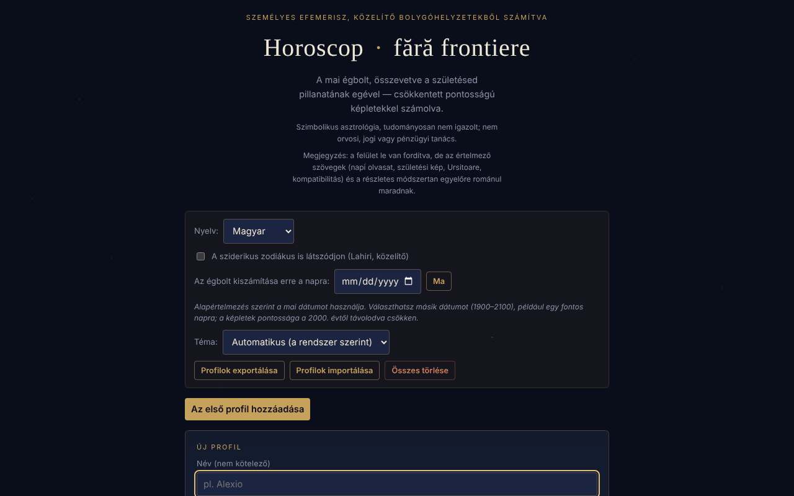

# Horoscop · fără frontiere

[English](README.md) · [Română](README.ro.md) · [Français](README.fr.md) · [Italiano](README.it.md) · [Español](README.es.md) · [Português](README.pt.md) · [Deutsch](README.de.md) · **Magyar**

**Verzió:** 1.3.2 · **Utolsó frissítés:** 2026-10-22

A felület nyelvei: **Română, English, Français, Italiano, Español, Português (PT), Deutsch, Magyar**

Személyes efemerisz, helyben számolva közelítő bolygópozíciókból (csökkentett pontosságú kepleri képletek): a mai égbolt, összevetve a születésed pillanatának égboltjával.

**Élő verzió:** https://chiuta.github.io/HoroScop/

## Mi ez

A Horoscop egyetlen HTML-fájlból álló alkalmazás, amely a böngészőben kiszámítja a Nap, a Hold és a nyolc bolygó pozícióját (kepleri pályaelemek, Schlyter / Meeus típusú, csökkentett pontosságú képletek), összeveti őket egy profil születési horoszkópjával, és napi „olvasatot” állít össze. Az alkalmazás a szövegben leszögezi, hogy az asztrológiát szimbolikusan kezeli, és nem becsül egészségügyi vagy halálozási kockázatokat.

## Funkciók

- Több profil (opcionális név, dátum, idő és UTC± időzóna, születési hely szélességgel/hosszúsággal az emelkedő jegyhez): „Hozzáadás”, „Szerkesztés”, „Duplikálás”, „Törlés”.
- A nap olvasata szakaszonként: Panoráma, Lélek & kapcsolatok, Munka & pénz, Test & energia, A nap tanácsa; „A mai olvasat másolása”.
- „A mai égbolt”, „A következő hét” (naponta a legerősebb szög), a mai elemek, retrográdok, üres futású Hold, lehetséges fogyatkozások, cazimi / combust.
- A születési horoszkóp, a horoszkóp szerkezete, jelentős születési szögek, a szögrozetta, 3D születési orrery (húzással forgatható).
- Szoláris revoluciók (a születéstől máig és előre vetítve), Szaturnusz-/Jupiter-/Hold-visszatérések.
- Egyszerűsített kompatibilitás (szinasztria) két profil között.
- „A szférák zenéje”: minden születési bolygó hanggá válik („▶ A horoszkópod lejátszása” / „■ Leállítás”).
- „Kozmikus portré”: körülbelül 6 másodperces, helyben generált videó, `portret-cosmic.webm` néven letölthető.
- Lehetőség a sziderikus zodiákusra (Lahiri, közelítő).
- „Az égbolt kiszámítása a dátumra”: másik dátumot választasz (1900–2100, helyi idő szerint 12:00), és minden szakasz (az égbolt, a szögek, a hét, az olvasat, a másolás) arra a napra számítódik; a „Ma” visszatér. A kiválasztott dátum nem őrződik meg a munkamenetek között.
- Téma: automatikus (a rendszerbeállítás szerint), sötét vagy világos; a választás helyben megmarad.
- „Hogyan számítódik ez” szakasz a becsült pontossággal és a korlátokkal (az asztrológiai házak nincsenek kiszámítva, csak az emelkedő jegy).

## Újdonságok (1.1.0)

Az oldal alján lévő összecsukható **„Helyi efemeriszek (FFF.ephem)”** kártya helyben (hálózat nélkül) számol egy helyre és az alkalmazásban kiválasztott dátumra („Az égbolt kiszámítása a dátumra”; alapértelmezés szerint ma):

- **Nap:** kelte, meridiánátmenet (a maximális magassággal), nyugta, a nap hossza, valamint a polgári, nautikai és csillagászati szürkület.
- **Hold:** fázis, megvilágítottság, kor, távolság, kelte/nyugta és a következő négy fázis (újhold, első negyed, telihold, utolsó negyed).
- **Pozíciók** a Naphoz, a Holdhoz és a nyolc bolygóhoz (+ Plútó): ekliptikai hosszúság jeggyel, magasság/azimut (refrakcióval), kelte/nyugta, fényesség, elongáció.
- **A „Δ” oszlop**: az alkalmazás egyszerű modelljéből (kepleri elemek, ez táplálja az olvasatokat) és az `FFF.ephem`-ből származó hosszúság különbsége ívpercben. 4 próbadátumon a különbségek: Nap ≤ 0,5′, bolygók ≤ 8′ (a legnagyobbak: Plútó, Uránusz), Hold legfeljebb ≈ 20′. A számok megmutatják, mennyire tévedhet az egyszerű modell; az olvasatok és a szögek **nem** módosultak.
- A hely: szél./hossz., név az alkalmazás városlistájából, az aktív profil (születési hely) vagy **GPS kétlépcsős hozzájárulással** (megerősítés az oldalon, majd egyetlen kérés; nem mentődik). Az időzóna a böngészőé alapján töltődik ki, és szerkeszthető (IANA-név).
- A deklarált pontosság megjelenik a kártyán („Pontosság” szakasz) és lejjebb.

A kártya csak románul van (az értelmezési szövegek nincsenek lefordítva; az alkalmazás többi része 8 nyelven érhető el), és nyomtatáskor el van rejtve.

## Használati útmutató

1. Nyomd meg az „Első profil hozzáadása” (vagy „Hozzáadás”) gombot.
2. Töltsd ki a születési dátumot; opcionálisan a nevet, az időt, az UTC± időzónát (Románia: télen +2, nyáron +3) és a hely szélességét/hosszúságát. Idő nélkül az emelkedő jegy nem számítható ki.
3. Nyomd meg a „Profil mentése” (vagy „Mégse”) gombot.
4. Olvasd el a nap szakaszait; a „↻ Frissítés most” újraszámítja az égboltot.
5. Jelöld be a sziderikus zodiákus lehetőséget, ha szeretnéd; az „Az égbolt kiszámítása a dátumra” funkcióval másik napon is láthatod az égboltot; a „Téma” alatt választhatod ki a megjelenést.
6. Zenéhez nyomd meg a „▶ A horoszkópod lejátszása” gombot; videóhoz a „🎬 Portré generálása” gombot, majd töltsd le a fájlt.
7. A „Profilok exportálása” fájlba menti a profilokat; a „Profilok importálása” újratölti őket; az „Összes törlése” eltávolítja őket. Az Escape billentyű bezárja a profilűrlapot (ha vannak más profilok).

## Adatvédelem és hálózat

- Helyi: a profilok a `localStorage`-ban vannak (`horoscopFF_profiles_v1`, az aktív profil `horoscopFF_active_v1`, a sziderikus beállítás `horoscopFF_sidereal_v1`, a téma `horoscopFF_theme_v1`). Ha a tárolás nem elérhető (privát mód), az alkalmazás figyelmeztetést jelenít meg, és a profilok export nélkül nem maradnak meg.
- Hálózat: az ellenőrzött kódban nincsenek `fetch` hívások, szkriptek vagy külső erőforrások; a számítások a böngészőben történnek.
- A felület 8 nyelvű (RO, EN, FR, IT, ES, PT, DE, HU); a hosszú értelmezési szövegek románul maradnak. A gépi fr/it/es/pt/hu/de fordításokat (felület és kit) anyanyelvi beszélők nem ellenőrizték.

- 1.1.0: a **helymeghatározást** (`navigator.geolocation`) csak akkor használja, ha az efemeriszkártyán megnyomod a „Saját helyem használata (GPS)” gombot, és az oldalon megerősíted. Nincsenek új hálózati kérések, és semmi új nem mentődik a `localStorage`-ba (a kártyának nincs tartós állapota). Az `fff-kit` kit (`core`, `label`, `bundle`, `ephem`) hozzáadja az átláthatósági gombot és a már meglévő kulcsok `fff.horoscop.__keys` indexét.
## Figyelmeztetés

Tájékoztató, szimbolikus és szórakoztató tartalom; nem helyettesít orvosi, jogi vagy pénzügyi tanácsot. Az asztrológiának nincs tudományos igazolása: a bolygók pozíciói csillagászati számítások (csökkentett pontosságú, Schlyter / Meeus típusú képletek), az értelmezések (az „olvasatok”) azonban kulturális hagyományok, nem igazolt előrejelzések. Ugyanez a megjegyzés szerepel az alkalmazás láblécében.

## Korlátok (az új funkciók)

- **Helyi efemeriszek — pontosság.** A fizikai referenciamodellhez (JPL DE421/DE423) képest a Nap és a bolygók látszólagos pozíciói ≤ 3″-cel térnek el (Neptunusz ≤ 5″, Plútó ≤ 7″), a Holdé ≤ 1,5″-cel; a Nap kelte/nyugta ≤ 6 s, a Holdé ≤ 25 s; a fázisok ≤ 30 s. A pyephem 4.2.1-hez képest (teszt a `tests/` könyvtárban): kelte/nyugta ≤ 0,5 s, fázisok ≤ 6 s, magasság/azimut ≤ 0,003°. Az időpontok percre kerekítve jelennek meg. **A valóságban** a kelte/nyugta percekkel eltér a valós refrakció, a domborzat és a tengerszint feletti magasság miatt (ezeket nem modellezi), és a ΔT 2027-ben kb. ±1 s bizonytalanságú. A fényességek tájékoztató jellegűek. Nem alkalmas navigációra vagy asztrometriai megfigyelésekre.
- Az alkalmazás többi része (olvasatok, szögek, születési horoszkópok) továbbra is az egyszerű, csökkentett pontosságú modellt használja; az új efemeriszek nem váltják fel. Az asztrológiai házak nincsenek kiszámítva az `FFF.ephem`-mel.

## Tesztek

`node tests/fff-r8.test.mjs` (Playwright az `/opt/node-tools` könyvtárból, helyi Chromium, letiltott hálózat; a `tests/_lib.mjs` tartalmazza a közös segédeszközöket). A referenciaértékek a `tests/ref-c3a.json` fájlban vannak: a kelte/nyugta/átmenet időpontjai (Nap, Hold; 5 hely × 4 dátum), 56 fázisidőpont és 54 magasság/azimut pozíció, a **pyephem 4.2.1**-gyel függetlenül kiszámítva (csak offline, a számok előállítására használták; nem része az alkalmazásnak). Minden teszt küszöbértéke a kódban van megírva; a hozzáférhetőségi teszt (axe-core, `bypassCSP`) a megnyitott párbeszédablakokban/panelekben is lefut, 1280×800 és 360×740 mellett.

## Helyi / offline futtatás

Töltsd le az `index.html` fájlt, és nyisd meg egy böngészőben; az ellenőrzött kódban nincs szüksége internetre.

## Licenc

MIT — lásd a `LICENSE` fájlt. © 2026 Alexandru-Ionuț Chiuță (Alexio). A fájlba esetleg beépített harmadik féltől származó könyvtárak megtartják saját licencüket.

Licenc: MIT (lásd a LICENSE fájlt). Elérhetőség: alexio@trom.tf

Ugyanez a nyilatkozat szerepel a HTML-fejlécben és az alkalmazás láblécében. A licenc szövege a LICENSE fájlban található.

## Előzmények / Changelog

### 1.3.2 — 2026-10-22
- Fordítási javítás: a „Nincs mentett profil” állapot azonnal frissül, ha a profilűrlap nyitva van közben nyelvet váltunk; a román README már nem tartalmaz angol sorokat.

### 2026. október 19. (v1.2.0)
- Új: „↗ A születésed égboltja, a TerRában” (csak idővel és hellyel); előzményfigyelmeztetés; a hely ~1 km-re kerekítve; a név nem kerül elküldésre.

### 1.1.0 — 2026-10-14
- Új: a „Helyi efemeriszek (FFF.ephem)” kártya (kelte/nyugta/átmenet, szürkületek, holdfázisok, magasság/azimut pozíciók, Δ oszlop az egyszerű modellhez képest, GPS kétlépcsős hozzájárulással, deklarált pontosság); az `fff-kit` kit (`core`, `label`, `bundle`, `ephem`); `tests/fff-r8.test.mjs` (47 ellenőrzés, beleértve az axe-ot világos és sötét témában, 1280×800 és 360×740 mellett). Előtte/utána összehasonlítás 1280×800 mellett: a kezdőoldal pixelre azonos (a kártya alapértelmezetten zárva van), így a képernyőkép nem változott.

- 1.0.0 — 2026-10-12: a verzió és az utolsó frissítés dátuma megjelenik az alkalmazásban (az első számozott verzió; a láblécben a régi „frissítve 2026. október 11-én” említés helyén).

7. kör:
- **Dokumentált numerikus ellenőrzés** (a képletek nem módosultak): a Nap 1992. 10. 13-án 0h TD → 199,902° szemben a 199,906°-kal (Meeus, *Astronomical Algorithms*, 25.a példa, pontos módszer, az értéket a pymeeus újra megerősítette); a Hold 1992. 04. 12-én 0h TD → 133,221° szemben a 133,163°-kal (47.a példa; különbség 0,06°); a GMST 1987. 04. 10-én 0h UT egyezik a Meeus 12.a példával (197,6932°); a 2026. 03. 20-i, 14:46 UTC-s napéjegyenlőség → napi hosszúság 0,004°. Az emelkedő jegyet 60 véletlen kombináción (1900–2099 évek, ±70° szélesség, tetszőleges hosszúság) összevetették egy független numerikus módszerrel — a legnagyobb eltérés 0,03° alatt. Az összefoglaló a „Hogyan számítódik ez” szakaszban látható. Az időpontokat UTC-ként kezeli (ΔT ≈ 1 perc nélkül).
- A CSP-hash újraszámítva; axe-core = 0 szabálysértés 1280 és 360 px mellett.

6. kör:
- Új: „Az égbolt kiszámítása a dátumra” (1900–2100) és a témaválasztás (automatikus / sötét / világos, világos palettával és a `prefers-color-scheme` támogatásával). A „ma” szövegek alkalmazkodnak, ha másik dátum van kiválasztva. A CSP-hash újraszámítva; a képernyőkép frissítve.
- Szinasztria: amíg nincs profil kiválasztva, a kártya mostantól „Válassz egy profilt a listából a kompatibilitás megtekintéséhez.” szöveget jelenít meg, ahelyett hogy üres maradna.
- Akadálymentesség: az oldal tartalma mostantól egy `<main>` elemben van (korábban csak akkor létezett, ha a grafikon látható volt); a szoláris revoluciók két görgethető listájának külön címkéje van; axe-core = 0 szabálysértés, profillal és anélkül, 1280 és 360 px mellett.
- A CSP-szabályzat mostantól hash alapján köti a szkriptet (korábban `'unsafe-inline'`).
- A csillagászati számítások dinamikusak (aktuális dátum); a képletek nem módosultak.

## Szerző

Alexio — Alexandru-Ionuț Chiuță, elérhetőség: alexio@trom.tf

## Összefoglaló

A Horoscop · fără frontiere egyfájlos, román nyelvű személyes efemerisz: a böngészőben számolja ki a bolygópozíciókat, összeveti a mai égboltot egy születési horoszkóppal, és napi olvasatokat, szögeket, szoláris revolúciókat, szinasztriát, 3D születési orrery-t, bolygóhangokból álló zenét és letölthető WebM-portrét mutat. A profilok a localStorage-ban vannak JSON-exporttal/-importtal. A kódban nem találtak hálózati kéréseket. Licenc: MIT (lásd a LICENSE fájlt) (elérhetőség: alexio@trom.tf).

## Audit

Audit: 2026-10-10 (2. kör, 2026-10-11: a „pontosan összevetve” / „valódi pozíciók” szlogent a módszertani szakasszal való összhang érdekében átfogalmazták — csökkentett pontosság, a jegy a csúcspontoknál egy nappal eltérhet) — ellenőrizve: 0 JS-hiba, nincsenek hálózati kérések (CSP `default-src 'none'; connect-src 'none'`), a profilnév nem okoz XSS-t (tesztelve jelöléssel a névben és a helyben). Javítva a lábléc kontrasztja, a szoláris revoluciók görgethető listája (mostantól billentyűzettel elérhető), és hozzáadva a fenti figyelmeztetés.

3. kör (2026-10-11): kifejezett licencnyilatkozat, amely korábban nem volt deklarálva (fejléc, lábléc, README), és jól látható asztrológiai figyelmeztető megjegyzés a cím alatt, RO és EN nyelven.
