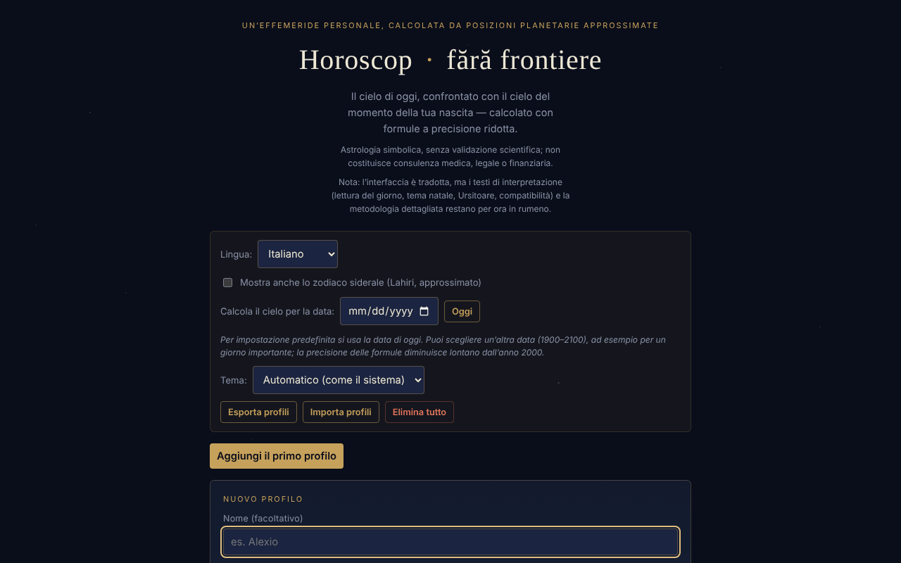

# Horoscop · fără frontiere

[English](README.md) · [Română](README.ro.md) · [Français](README.fr.md) · **Italiano** · [Español](README.es.md) · [Português](README.pt.md) · [Deutsch](README.de.md) · [Magyar](README.hu.md)

**Versione:** 1.3.8 · **Ultimo aggiornamento:** 2026-10-23

Lingue dell'interfaccia: **Română, English, Français, Italiano, Español, Português (PT), Deutsch, Magyar**

Un'effemeride personale, calcolata in locale da posizioni planetarie approssimate (formule kepleriane a precisione ridotta): il cielo di oggi, confrontato con il cielo del momento della tua nascita.

**Online:** https://chiuta.github.io/HoroScop/

## Che cos'è

Horoscop è un'applicazione in un unico file HTML che calcola nel browser le posizioni del Sole, della Luna e degli otto pianeti (elementi orbitali kepleriani, formule a precisione ridotta di tipo Schlyter / Meeus), le confronta con il tema natale di un profilo e compone una «lettura» quotidiana. L'applicazione precisa nel testo che l'astrologia è trattata in modo simbolico e che non stima rischi per la salute né di mortalità.

## Funzioni

- Profili multipli (nome facoltativo, data, ora e fuso orario UTC±, luogo di nascita con latitudine/longitudine per l'ascendente): «Aggiungi», «Modifica», «Duplica», «Elimina».
- La lettura del giorno per sezioni: Panorama, Anima & relazioni, Lavoro & denaro, Corpo & energia, Consiglio del giorno; «Copia la lettura di oggi».
- «Il cielo di oggi», «La settimana in arrivo» (l'aspetto più forte per giorno), elementi di oggi, retrogradi, Luna vuota di corso, possibili eclissi, cazimi / combusto.
- Il tema natale, la struttura del tema, gli aspetti natali significativi, la rosa degli aspetti, un orrery natale 3D (rotazione trascinando).
- Rivoluzioni solari (dalla nascita a oggi e proiezione in avanti), ritorni di Saturno / Giove / Luna.
- Compatibilità (sinastria) semplificata tra due profili.
- «Musica delle sfere»: ogni pianeta natale diventa un tono («▶ Suona il tuo tema» / «■ Ferma»).
- «Ritratto cosmico»: un video di circa 6 secondi generato in locale, scaricabile come `portret-cosmic.webm`.
- Opzione per lo zodiaco siderale (Lahiri, approssimato).
- «Calcola il cielo per la data»: scegli un'altra data (1900–2100, ore 12:00 locali) e tutte le sezioni (il cielo, gli aspetti, la settimana, la lettura, la copia) vengono calcolate per quel giorno; «Oggi» ritorna alla data corrente. La data scelta non viene conservata tra una sessione e l'altra.
- Tema: automatico (secondo la preferenza del sistema), scuro o chiaro; la scelta viene conservata in locale.
- Sezione «Come si calcola» con la precisione stimata e i limiti (le case astrologiche non vengono calcolate, solo l'ascendente).

## Novità (1.1.0)

La scheda comprimibile **«Effemeridi locali (FFF.ephem)»**, in fondo alla pagina, calcola in locale (senza rete), per un luogo e per la data scelta nell'applicazione («Calcola il cielo per la data»; oggi per impostazione predefinita):

- **Sole:** alba, passaggio al meridiano (con l'altezza massima), tramonto, durata del giorno e crepuscoli civile, nautico, astronomico.
- **Luna:** fase, illuminazione, età, distanza, sorgere/tramonto e le quattro fasi successive (luna nuova, primo quarto, luna piena, ultimo quarto).
- **Posizioni** di Sole, Luna e degli otto pianeti (+ Plutone): longitudine eclittica con segno, altezza/azimut (con rifrazione), sorgere/tramonto, magnitudine, elongazione.
- **La colonna «Δ»**: la differenza, in minuti d'arco, tra la longitudine del modello semplice dell'applicazione (elementi kepleriani, quello che alimenta le letture) e quella di `FFF.ephem`. Su 4 date di prova le differenze sono state: Sole ≤ 0,5′, pianeti ≤ 8′ (i maggiori: Plutone, Urano), Luna fino a ≈ 20′. Le cifre mostrano quanto può sbagliare il modello semplice; le letture e gli aspetti **non** sono stati modificati.
- Il luogo: lat/lon, nome dall'elenco di città dell'applicazione, profilo attivo (luogo di nascita) o **GPS con consenso in due passaggi** (conferma nella pagina, poi una sola richiesta; non viene salvato). Il fuso orario viene compilato con quello del browser e può essere modificato (nome IANA).
- La precisione dichiarata compare nella scheda (sezione «Precisione») e più in basso.

La scheda è solo in romeno (i testi di interpretazione non sono tradotti; il resto dell'applicazione è disponibile in 8 lingue), e viene nascosta in stampa.

## Guida all'uso

1. Premi «Aggiungi il primo profilo» (o «Aggiungi»).
2. Compila la data di nascita; facoltativamente il nome, l'ora, il fuso orario UTC± (Romania: +2 in inverno, +3 in estate) e la latitudine/longitudine del luogo. Senza l'ora, l'ascendente non può essere calcolato.
3. Premi «Salva il profilo» (o «Annulla»).
4. Leggi le sezioni del giorno; «↻ Aggiorna ora» ricalcola il cielo.
5. Spunta l'opzione dello zodiaco siderale se vuoi; da «Calcola il cielo per la data» puoi vedere il cielo in un altro giorno; da «Tema» scegli l'aspetto.
6. Per la musica premi «▶ Suona il tuo tema»; per il video «🎬 Genera il ritratto», poi scarica il file.
7. «Esporta profili» salva i profili in un file; «Importa profili» li ricarica; «Elimina tutto» li rimuove. Il tasto Esc chiude il modulo del profilo (se esistono altri profili).

## Privacy e rete

- Locale: i profili sono conservati in `localStorage` (`horoscopFF_profiles_v1`, il profilo attivo `horoscopFF_active_v1`, l'opzione siderale `horoscopFF_sidereal_v1`, il tema `horoscopFF_theme_v1`). Se l'archiviazione non è disponibile (modalità privata), l'applicazione mostra un avviso e i profili non vengono conservati senza esportazione.
- Rete: nel codice verificato non ci sono chiamate `fetch`, script o risorse esterne; i calcoli si fanno nel browser.
- L'interfaccia ha 8 lingue (RO, EN, FR, IT, ES, PT, DE, HU); i testi lunghi di interpretazione restano in rumeno. Le traduzioni automatiche fr/it/es/pt/hu/de (interfaccia e kit) non sono verificate da madrelingua.

- 1.1.0: la **geolocalizzazione** (`navigator.geolocation`) viene usata solo se premi «Usa la mia posizione (GPS)» nella scheda delle effemeridi e confermi nella pagina. Non ci sono nuove richieste di rete e non viene salvato nulla di nuovo in `localStorage` (la scheda non ha uno stato persistente). Il kit `fff-kit` (`core`, `label`, `bundle`, `ephem`) aggiunge il pulsante di trasparenza e l'indice `fff.horoscop.__keys` delle chiavi già esistenti.
## Avvertenza

Contenuto informativo, simbolico e di intrattenimento; non sostituisce un parere medico, legale o finanziario. L'astrologia non ha validazione scientifica: le posizioni dei pianeti sono calcoli astronomici (a precisione ridotta, formule di tipo Schlyter / Meeus), ma le interpretazioni (le «letture») sono tradizione culturale, non previsioni validate. La stessa nota compare nel piè di pagina dell'applicazione.

## Limiti (le nuove funzioni)

- **Effemeridi locali — precisione.** Rispetto al modello fisico di riferimento (JPL DE421/DE423) le posizioni apparenti di Sole e pianeti differiscono di ≤ 3″ (Nettuno ≤ 5″, Plutone ≤ 7″), quelle della Luna di ≤ 1,5″; alba/tramonto del Sole ≤ 6 s, della Luna ≤ 25 s; le fasi ≤ 30 s. Rispetto a pyephem 4.2.1 (test in `tests/`): alba/tramonto ≤ 0,5 s, fasi ≤ 6 s, alt/az ≤ 0,003°. Gli orari sono mostrati arrotondati al minuto. **Nella realtà** alba e tramonto differiscono di minuti a causa della rifrazione reale, del rilievo e della quota (non modellati), e ΔT è incerto di circa ±1 s nel 2027. Le magnitudini sono indicative. Non adatto alla navigazione né a osservazioni astrometriche.
- Il resto dell'applicazione (letture, aspetti, temi natali) usa ancora il modello semplice a precisione ridotta; le nuove effemeridi non lo sostituiscono. Le case astrologiche non vengono calcolate con `FFF.ephem`.

## Test

`node tests/fff-r8.test.mjs` (Playwright da `/opt/node-tools`, Chromium locale, rete bloccata; `tests/_lib.mjs` contiene le utilità comuni). I valori di riferimento sono in `tests/ref-c3a.json`: gli istanti di alba/tramonto/passaggio (Sole, Luna; 5 luoghi × 4 date), 56 istanti di fase e 54 posizioni alt/az, calcolati in modo indipendente con **pyephem 4.2.1** (usato solo offline per generare i numeri; non fa parte dell'applicazione). Ogni test ha la soglia scritta nel codice; il test di accessibilità (axe-core, `bypassCSP`) viene eseguito anche nei dialoghi/pannelli aperti, a 1280×800 e 360×740.

## Uso locale / offline

Scarica `index.html` e aprilo in un browser; nel codice verificato non richiede Internet.

## Licenza

MIT — vedi il file `LICENSE`. © 2026 Alexandru-Ionuț Chiuță (Alexio). Eventuali librerie di terze parti incluse nel file mantengono le proprie licenze.

Licenza: MIT (vedi il file LICENSE). Contatto: alexio@trom.tf

La stessa dichiarazione compare nell'intestazione HTML e nel piè di pagina dell'applicazione. Il testo della licenza si trova nel file LICENSE.

## Cronologia / Changelog

### 1.3.7 — 2026-10-22

fff-kit 1.1.4: aree tattili e testo minimo.

### 1.3.6 — 2026-10-22

fff-kit 1.1.2: PBKDF2 a 600.000 iterazioni, protezione anti-clickjacking.

### 1.3.5 — 2026-10-22
- Le finestre confirm()/prompt() del browser sostituite da finestre di dialogo proprie, tradotte nelle 8 lingue (eliminazione del profilo, cancellazione di tutti i dati (due passaggi), copia manuale); casella dello zodiaco siderale da 24 px; etichetta «eyebrow» a 12 px.

### 1.3.4 — 2026-10-22
- Footer: removed duplicated license and disclaimer lines (Romanian).

### 1.3.3 — 2026-10-22
- Correzione di traduzione: la descrizione (e il nome) nel pannello di trasparenza seguono ora la lingua dell'interfaccia. L'aria-label della rosetta degli aspetti è tradotto e le righe a piè di pagina rimaste in inglese nell'interfaccia rumena sono ora in rumeno.

### 1.3.2 — 2026-10-22
- Correzione di traduzione: lo stato «nessun profilo salvato» si aggiorna subito al cambio di lingua mentre il modulo del profilo è aperto; il README rumeno non contiene più righe in inglese.

### 19 ottobre 2026 (v1.2.0)
- Nuovo: «↗ Il cielo della tua nascita, in TerRa» (solo con ora e luogo); avviso di cronologia; luogo arrotondato a ~1 km; il nome non viene inviato.

### 1.1.0 — 2026-10-14
- Nuovo: la scheda «Effemeridi locali (FFF.ephem)» (alba/tramonto/passaggio, crepuscoli, fasi lunari, posizioni alt/az, colonna Δ rispetto al modello semplice, GPS con consenso in due passaggi, precisione dichiarata); il kit `fff-kit` (`core`, `label`, `bundle`, `ephem`); `tests/fff-r8.test.mjs` (47 verifiche, incluso axe nei temi chiaro e scuro, a 1280×800 e 360×740). Confronto prima/dopo a 1280×800: la pagina iniziale è identica pixel per pixel (la scheda è chiusa per impostazione predefinita), quindi la schermata non è cambiata.

- 1.0.0 — 2026-10-12: la versione e la data dell'ultimo aggiornamento sono mostrate nell'app (prima versione numerata; nel piè di pagina, al posto della vecchia dicitura «aggiornato l'11 ottobre 2026»).

Round 7:
- **Verifica numerica documentata** (le formule non sono state modificate): il Sole il 13.10.1992 0h TD → 199,902° contro 199,906° (Meeus, *Astronomical Algorithms*, es. 25.a, metodo preciso, valore riconfermato tramite pymeeus); la Luna il 12.04.1992 0h TD → 133,221° contro 133,163° (es. 47.a; differenza 0,06°); il GMST il 10.04.1987 0h UT coincide con l'esempio 12.a di Meeus (197,6932°); l'equinozio del 20.03.2026, 14:46 UTC → longitudine solare 0,004°. L'ascendente è stato confrontato su 60 combinazioni casuali (anni 1900–2099, latitudini ±70°, qualsiasi longitudine) con un metodo numerico indipendente — differenza massima inferiore a 0,03°. Il riepilogo compare nella sezione «Come si calcola». Gli istanti sono trattati come UTC (senza ΔT ≈ 1 minuto).
- Hash CSP ricalcolato; axe-core = 0 violazioni a 1280 e 360 px.

Round 6:
- Nuovo: «Calcola il cielo per la data» (1900–2100) e la scelta del tema (automatico / scuro / chiaro, con tavolozza chiara e supporto per `prefers-color-scheme`). I testi «oggi» si adattano quando è scelta un'altra data. Hash CSP ricalcolato; schermata aggiornata.
- Sinastria: finché non è scelto alcun profilo, la scheda mostra ora «Scegli un profilo dall'elenco per vedere la compatibilità.», invece di restare vuota.
- Accessibilità: il contenuto della pagina è ora in un `<main>` (prima esisteva solo quando il grafico era visibile); le due liste scorrevoli delle rivoluzioni solari hanno etichette distinte; axe-core = 0 violazioni, con e senza profilo, a 1280 e 360 px.
- La politica CSP lega ora lo script tramite hash (prima `'unsafe-inline'`).
- I calcoli astronomici sono dinamici (data corrente); le formule non sono state modificate.

## Autore

Alexio — Alexandru-Ionuț Chiuță, contatto: alexio@trom.tf

## Riepilogo

Horoscop · fără frontiere è un'effemeride personale in lingua romena, in un unico file: calcola le posizioni planetarie nel browser, confronta il cielo di oggi con un tema natale e mostra letture quotidiane, aspetti, rivoluzioni solari, sinastria, un orrery natale 3D, musica di toni planetari e un ritratto WebM scaricabile. I profili risiedono in localStorage con esportazione/importazione JSON. Nel codice non sono state trovate richieste di rete. Licenza: MIT (vedi il file LICENSE) (contatto: alexio@trom.tf).

## Audit

Audit: 2026-10-10 (round 2, 2026-10-11: lo slogan «confrontato esattamente» / «posizioni reali» riformulato per coerenza con la sezione di metodologia — precisione ridotta, il segno può differire di un giorno alle cuspidi) — verificato: 0 errori JS, nessuna richiesta di rete (CSP `default-src 'none'; connect-src 'none'`), il nome del profilo non produce XSS (testato con markup nel nome e nel luogo). Corretti il contrasto del piè di pagina, la lista scorrevole delle rivoluzioni solari (ora accessibile da tastiera) e aggiunta l'avvertenza di cui sopra.

Round 3 (2026-10-11): dichiarazione esplicita di licenza che non era stata dichiarata (intestazione, piè di pagina, README) e nota di avvertenza astrologica visibile sotto il titolo, in RO ed EN.
