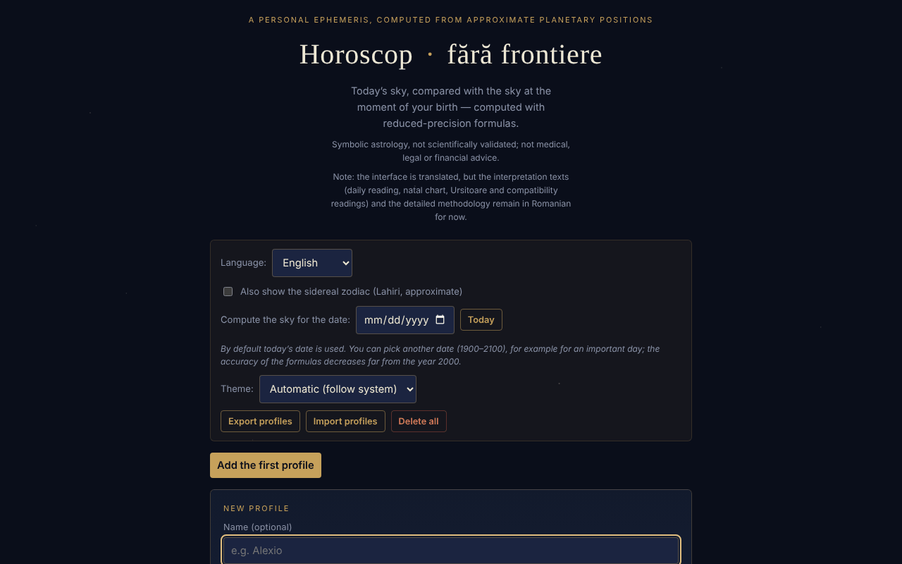

# Horoscop · fără frontiere

**English** · [Română](README.ro.md) · [Français](README.fr.md) · [Italiano](README.it.md) · [Español](README.es.md) · [Português](README.pt.md) · [Deutsch](README.de.md) · [Magyar](README.hu.md)

**Version:** 1.3.7 · **Last updated:** 2026-10-22

Interface languages: **Română, English, Français, Italiano, Español, Português (PT), Deutsch, Magyar**

A personal ephemeris, computed locally from approximate planetary positions (low-precision Keplerian formulas): today's sky, compared with the sky at the moment of your birth.

**Live:** https://chiuta.github.io/HoroScop/

## What it is

Horoscop is a single-HTML-file app that computes in the browser the positions of the Sun, the Moon and the eight planets (Keplerian orbital elements, low-precision formulas of the Schlyter / Meeus type), compares them with the natal chart of a profile and composes a daily "reading". The app states in the text that astrology is treated symbolically and that it does not estimate health or mortality risks.

## Features

- Multiple profiles (optional name, date, time and UTC± time zone, birthplace with latitude/longitude for the ascendant): "Add", "Edit", "Duplicate", "Delete".
- The day's reading by sections: Panorama, Soul & relationships, Work & money, Body & energy, Advice of the day; "Copy today's reading".
- "Today's sky", "The coming week" (the strongest aspect per day), today's elements, retrogrades, Moon void of course, possible eclipses, cazimi / combust.
- The natal chart, the structure of the chart, significant natal aspects, the aspect rosette, a 3D natal orrery (rotate by dragging).
- Solar returns (from birth until today and a projection forward), Saturn / Jupiter / Moon returns.
- Simplified compatibility (synastry) between two profiles.
- "Music of the spheres": each natal planet becomes a tone ("▶ Play your chart" / "■ Stop").
- "Cosmic portrait": a video of about 6 seconds generated locally, downloadable as `portret-cosmic.webm`.
- Option for the sidereal zodiac (Lahiri, approximate).
- "Compute the sky for the date": you choose another date (1900–2100, 12:00 local time) and all the sections (the sky, the aspects, the week, the reading, copying) are computed for that day; "Today" returns. The chosen date is not kept between sessions.
- Theme: automatic (according to the system preference), dark or light; the choice is kept locally.
- A "How this is computed" section with the estimated accuracy and the limits (the astrological houses are not computed, only the ascendant).

## New features (1.1.0)

The collapsible card **"Local ephemerides (FFF.ephem)"**, at the bottom of the page, computes locally (without the network), for a place and for the date chosen in the app ("Compute the sky for the date"; today by default):

- **Sun:** sunrise, meridian transit (with the maximum altitude), sunset, the length of the day and the civil, nautical and astronomical twilights.
- **Moon:** phase, illumination, age, distance, rise/set and the next four phases (new moon, first quarter, full moon, last quarter).
- **Positions** for the Sun, the Moon and the eight planets (+ Pluto): ecliptic longitude with sign, altitude/azimuth (with refraction), rise/set, magnitude, elongation.
- **The "Δ" column**: the difference, in arcminutes, between the longitude from the app's simple model (Keplerian elements, the one that feeds the readings) and that from `FFF.ephem`. At 4 test dates the differences were: Sun ≤ 0.5′, planets ≤ 8′ (the largest: Pluto, Uranus), Moon up to ≈ 20′. The figures show how far the simple model can be wrong; the readings and aspects were **not** changed.
- The place: lat/lon, a name from the app's list of cities, the active profile (birthplace) or **GPS with two-step consent** (in-page confirmation, then a single request; it is not saved). The time zone is filled in with the browser's and can be edited (IANA name).
- The declared accuracy appears in the card (the "Accuracy" section) and below.

The card is in Romanian only (the interpretation texts are not translated; the rest of the app is available in 8 languages), and is hidden when printing.

## User guide

1. Press "Add your first profile" (or "Add").
2. Fill in the date of birth; optionally the name, the time, the UTC± time zone (Romania: +2 in winter, +3 in summer) and the latitude/longitude of the place. Without a time, the ascendant cannot be computed.
3. Press "Save profile" (or "Cancel").
4. Read the day's sections; "↻ Update now" recomputes the sky.
5. Tick the sidereal zodiac option if you wish; from "Compute the sky for the date" you can see the sky on another day; from "Theme" you choose the appearance.
6. For music press "▶ Play your chart"; for video "🎬 Generate the portrait", then download the file.
7. "Export profiles" saves the profiles to a file; "Import profiles" reloads them; "Delete all" removes them. The Escape key closes the profile form (if there are other profiles).

## Privacy and network

- Local: profiles are kept in `localStorage` (`horoscopFF_profiles_v1`, the active profile `horoscopFF_active_v1`, the sidereal option `horoscopFF_sidereal_v1`, the theme `horoscopFF_theme_v1`). If storage is unavailable (private mode), the app shows a warning and the profiles are not kept without an export.
- Network: in the verified code there are no `fetch` calls, scripts or external resources; the calculations are done in the browser.
- The interface has 8 languages (RO, EN, FR, IT, ES, PT, DE, HU); the long interpretation texts remain in Romanian. The machine translations fr/it/es/pt/hu/de (interface and kit) are not checked by native speakers.

- 1.1.0: **geolocation** (`navigator.geolocation`) is used only if you press "Use my location (GPS)" in the ephemerides card and confirm in the page. There are no new network requests and nothing new is saved in `localStorage` (the card has no persistent state). The `fff-kit` kit (`core`, `label`, `bundle`, `ephem`) adds the transparency button and the index `fff.horoscop.__keys` of the already existing keys.
## Warning

Informative, symbolic and entertainment content; it does not replace medical, legal or financial advice. Astrology has no scientific validation: the planetary positions are astronomical calculations (low-precision, Schlyter / Meeus-type formulas), but the interpretations (the "readings") are cultural tradition, not validated predictions. The same note appears in the app's footer.

## Limits (the new features)

- **Local ephemerides — accuracy.** Against the reference physical model (JPL DE421/DE423), the apparent positions of the Sun and planets differ by ≤ 3″ (Neptune ≤ 5″, Pluto ≤ 7″), those of the Moon by ≤ 1.5″; sunrise/sunset of the Sun ≤ 6 s, of the Moon ≤ 25 s; phases ≤ 30 s. Against pyephem 4.2.1 (test in `tests/`): rise/set ≤ 0.5 s, phases ≤ 6 s, alt/az ≤ 0.003°. Times are displayed rounded to the minute. **In reality** sunrise/sunset differ by minutes because of real refraction, relief and altitude (not modelled), and ΔT is uncertain by about ±1 s in 2027. Magnitudes are indicative. Not suitable for navigation or astrometric observations.
- The rest of the app (readings, aspects, natal charts) still uses the simple low-precision model; the new ephemerides do not replace it. The astrological houses are not computed with `FFF.ephem`.

## Tests

`node tests/fff-r8.test.mjs` (Playwright from `/opt/node-tools`, local Chromium, network blocked; `tests/_lib.mjs` has the common helpers). The reference values are in `tests/ref-c3a.json`: the rise/set/transit times (Sun, Moon; 5 places × 4 dates), 56 phase times and 54 alt/az positions, computed independently with **pyephem 4.2.1** (used only offline to generate the numbers; it is not part of the app). Each test has its threshold written in the code; the accessibility test (axe-core, `bypassCSP`) also runs in open dialogs/panels, at 1280×800 and 360×740.

## Local / offline use

Download `index.html` and open it in a browser; in the verified code it does not need the internet.

## License

MIT — see the `LICENSE` file. © 2026 Alexandru-Ionuț Chiuță (Alexio). Any third-party libraries included in the file keep their own licenses.

License: MIT (see the LICENSE file). Contact: alexio@trom.tf

The same statement appears in the HTML header and in the app's footer. The license text is in the LICENSE file.

## History / Changelog

### 1.3.7 — 2026-10-22

fff-kit 1.1.4: touch targets and minimum text size.

### 1.3.6 — 2026-10-22

fff-kit 1.1.2: PBKDF2 with 600,000 iterations, anti-clickjacking protection.

### 1.3.5 — 2026-10-22
- Native browser confirm()/prompt() boxes replaced by own dialogs translated into the 8 languages (profile deletion, clearing all data (two steps), manual copy); sidereal checkbox of 24 px; the "eyebrow" label at 12 px.

### 1.3.4 — 2026-10-22
- Footer: removed duplicated license and disclaimer lines (Romanian).

### 1.3.3 — 2026-10-22
- Translation fix: the description (and name) in the transparency panel now follow the interface language. The aspect rosette aria-label is translated, and the English-only footer lines in the Romanian interface are now Romanian.

### 1.3.2 — 2026-10-22
- Translation fix: the "no profile saved" status now updates immediately when the language is changed while the profile form is open; the Romanian README no longer contains English lines.

### 19 October 2026 (v1.2.0)
- New: "↗ Your birth sky, in TerRa" (only with time and place); a history warning; the place rounded to ~1 km; the name is not sent.

### 1.1.0 — 2026-10-14
- New: the "Local ephemerides (FFF.ephem)" card (rise/set/transit, twilights, Moon phases, alt/az positions, the Δ column against the simple model, GPS with two-step consent, declared accuracy); the `fff-kit` kit (`core`, `label`, `bundle`, `ephem`); `tests/fff-r8.test.mjs` (47 checks, including axe in the light and dark themes, at 1280×800 and 360×740). Before/after comparison at 1280×800: the initial page is pixel-for-pixel identical (the card is closed by default), so the screenshot did not change.

- 1.0.0 — 2026-10-12: the version and the date of the last update are shown in the app (the first numbered version; in the footer, in place of the old "updated 11 October 2026" mention).

Round 7:
- **Documented numerical verification** (the formulas were not modified): the Sun on 13.10.1992 0h TD → 199.902° versus 199.906° (Meeus, *Astronomical Algorithms*, ex. 25.a, precise method, value reconfirmed through pymeeus); the Moon on 12.04.1992 0h TD → 133.221° versus 133.163° (ex. 47.a; difference 0.06°); GMST on 10.04.1987 0h UT matches Meeus example 12.a (197.6932°); the equinox of 20.03.2026, 14:46 UTC → solar longitude 0.004°. The ascendant was compared on 60 random combinations (years 1900–2099, latitudes ±70°, any longitude) with an independent numerical method — maximum difference under 0.03°. The summary appears in the "How this is computed" section. The moments are treated as UTC (without ΔT ≈ 1 minute).
- CSP hash recalculated; axe-core = 0 violations at 1280 and 360 px.

Round 6:
- New: "Compute the sky for the date" (1900–2100) and the theme choice (automatic / dark / light, with a light palette and support for `prefers-color-scheme`). The "today" texts adapt when another date is chosen. CSP hash recalculated; screenshot refreshed.
- Synastry: as long as no profile is chosen, the card now shows "Choose a profile from the list to see compatibility.", instead of staying empty.
- Accessibility: the page content is now in a `<main>` (previously it existed only when the chart was visible); the two scrollable lists of solar returns have distinct labels; axe-core = 0 violations, with and without a profile, at 1280 and 360 px.
- The CSP policy now binds the script by hash (previously `'unsafe-inline'`).
- The astronomical calculations are dynamic (the current date); the formulas were not modified.

## Author

Alexio — Alexandru-Ionuț Chiuță, contact: alexio@trom.tf

## Summary

Horoscop · fără frontiere is a single-file Romanian-language personal ephemeris: it computes planetary positions in the browser, compares today's sky with a natal chart, and shows daily readings, aspects, solar returns, synastry, a 3D natal orrery, planet-tone music and a downloadable WebM portrait. Profiles live in localStorage with JSON export/import. No network requests were found in the code. License: MIT (see the LICENSE file) (contact: alexio@trom.tf).

## Audit

Audit: 2026-10-10 (round 2, 2026-10-11: the slogan "compared exactly" / "real positions" reworded for consistency with the methodology section — low precision, the sign may differ by a day at the cusps) — verified: 0 JS errors, no network requests (CSP `default-src 'none'; connect-src 'none'`), the profile name does not produce XSS (tested with markup in the name and place). Fixed the footer contrast, the scrollable list of solar returns (now keyboard-accessible) and added the warning above.

Round 3 (2026-10-11): an explicit license statement that had not been declared (header, footer, README) and a visible astrological warning note under the title, in RO and EN.
