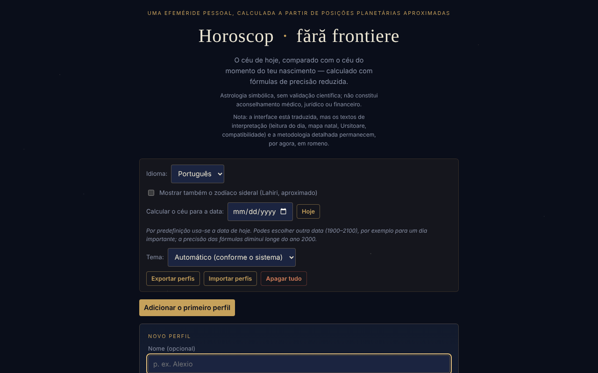

# Horoscop · fără frontiere

[English](README.md) · [Română](README.ro.md) · [Français](README.fr.md) · [Italiano](README.it.md) · [Español](README.es.md) · **Português** · [Deutsch](README.de.md) · [Magyar](README.hu.md)

**Versão:** 1.3.7 · **Última atualização:** 2026-10-22

Idiomas da interface: **Română, English, Français, Italiano, Español, Português (PT), Deutsch, Magyar**

Uma efeméride pessoal, calculada localmente a partir de posições planetárias aproximadas (fórmulas keplerianas de precisão reduzida): o céu de hoje, comparado com o céu do momento do seu nascimento.

**Online:** https://chiuta.github.io/HoroScop/

## O que é

O Horoscop é uma aplicação num único ficheiro HTML que calcula no navegador as posições do Sol, da Lua e dos oito planetas (elementos orbitais keplerianos, fórmulas de precisão reduzida do tipo Schlyter / Meeus), compara-as com o mapa natal de um perfil e compõe uma «leitura» diária. A aplicação esclarece no texto que a astrologia é tratada de forma simbólica e que não estima riscos de saúde nem de mortalidade.

## Funcionalidades

- Perfis múltiplos (nome opcional, data, hora e fuso horário UTC±, local de nascimento com latitude/longitude para o ascendente): «Adicionar», «Editar», «Duplicar», «Eliminar».
- A leitura do dia por secções: Panorama, Alma & relações, Trabalho & dinheiro, Corpo & energia, Conselho do dia; «Copiar a leitura de hoje».
- «O céu de hoje», «A semana que vem» (o aspeto mais forte por dia), elementos de hoje, retrógrados, Lua sem curso, possíveis eclipses, cazimi / combusto.
- O mapa natal, a estrutura do mapa, os aspetos natais significativos, a rosa dos aspetos, um orrery natal 3D (rotação por arrastamento).
- Revoluções solares (do nascimento até hoje e projeção para a frente), retornos de Saturno / Júpiter / Lua.
- Compatibilidade (sinastria) simplificada entre dois perfis.
- «Música das esferas»: cada planeta natal torna-se um tom («▶ Tocar o seu mapa» / «■ Parar»).
- «Retrato cósmico»: um vídeo de cerca de 6 segundos gerado localmente, descarregável como `portret-cosmic.webm`.
- Opção para o zodíaco sideral (Lahiri, aproximado).
- «Calcular o céu para a data»: escolhe outra data (1900–2100, às 12:00 hora local) e todas as secções (o céu, os aspetos, a semana, a leitura, a cópia) são calculadas para esse dia; «Hoje» regressa à data atual. A data escolhida não é guardada entre sessões.
- Tema: automático (de acordo com a preferência do sistema), escuro ou claro; a escolha é guardada localmente.
- Secção «Como se calcula isto» com a precisão estimada e os limites (as casas astrológicas não são calculadas, apenas o ascendente).

## Novidades (1.1.0)

O cartão recolhível **«Efemérides locais (FFF.ephem)»**, no fim da página, calcula localmente (sem rede), para um local e para a data escolhida na aplicação («Calcular o céu para a data»; hoje por predefinição):

- **Sol:** nascer, passagem pelo meridiano (com a altitude máxima), pôr, duração do dia e crepúsculos civil, náutico, astronómico.
- **Lua:** fase, iluminação, idade, distância, nascer/pôr e as quatro fases seguintes (lua nova, quarto crescente, lua cheia, quarto minguante).
- **Posições** do Sol, da Lua e dos oito planetas (+ Plutão): longitude eclítica com signo, altitude/azimute (com refração), nascer/pôr, magnitude, elongação.
- **A coluna «Δ»**: a diferença, em minutos de arco, entre a longitude do modelo simples da aplicação (elementos keplerianos, o que alimenta as leituras) e a de `FFF.ephem`. Em 4 datas de teste as diferenças foram: Sol ≤ 0,5′, planetas ≤ 8′ (os maiores: Plutão, Úrano), Lua até ≈ 20′. Os números mostram quanto o modelo simples se pode enganar; as leituras e os aspetos **não** foram modificados.
- O local: lat/lon, nome da lista de cidades da aplicação, perfil ativo (local de nascimento) ou **GPS com consentimento em dois passos** (confirmação na página, depois um único pedido; não é guardado). O fuso horário é preenchido com o do navegador e pode ser editado (nome IANA).
- A precisão declarada aparece no cartão (secção «Precisão») e mais abaixo.

O cartão está apenas em romeno (os textos de interpretação não estão traduzidos; o resto da aplicação está disponível em 8 idiomas), e fica oculto na impressão.

## Manual de utilização

1. Prima «Adicionar o primeiro perfil» (ou «Adicionar»).
2. Preencha a data de nascimento; opcionalmente o nome, a hora, o fuso horário UTC± (Roménia: +2 no inverno, +3 no verão) e a latitude/longitude do local. Sem hora, o ascendente não pode ser calculado.
3. Prima «Guardar o perfil» (ou «Cancelar»).
4. Leia as secções do dia; «↻ Atualizar agora» recalcula o céu.
5. Assinale a opção do zodíaco sideral, se desejar; em «Calcular o céu para a data» pode ver o céu noutro dia; em «Tema» escolhe o aspeto.
6. Para a música prima «▶ Tocar o seu mapa»; para o vídeo «🎬 Gerar o retrato» e depois descarregue o ficheiro.
7. «Exportar perfis» guarda os perfis num ficheiro; «Importar perfis» volta a carregá-los; «Eliminar tudo» remove-os. A tecla Escape fecha o formulário de perfil (se existirem outros perfis).

## Privacidade e rede

- Local: os perfis são guardados em `localStorage` (`horoscopFF_profiles_v1`, o perfil ativo `horoscopFF_active_v1`, a opção sideral `horoscopFF_sidereal_v1`, o tema `horoscopFF_theme_v1`). Se o armazenamento não estiver disponível (modo privado), a aplicação mostra um aviso e os perfis não são guardados sem exportação.
- Rede: no código verificado não existem chamadas `fetch`, scripts nem recursos externos; os cálculos são feitos no navegador.
- A interface tem 8 idiomas (RO, EN, FR, IT, ES, PT, DE, HU); os textos longos de interpretação permanecem em romeno. As traduções automáticas fr/it/es/pt/hu/de (interface e kit) não são verificadas por falantes nativos.

- 1.1.0: a **geolocalização** (`navigator.geolocation`) só é usada se premir «Usar a minha localização (GPS)» no cartão das efemérides e confirmar na página. Não há novos pedidos de rede e não é guardado nada de novo em `localStorage` (o cartão não tem estado persistente). O kit `fff-kit` (`core`, `label`, `bundle`, `ephem`) acrescenta o botão de transparência e o índice `fff.horoscop.__keys` das chaves já existentes.
## Aviso

Conteúdo informativo, simbólico e de entretenimento; não substitui o aconselhamento médico, jurídico ou financeiro. A astrologia não tem validação científica: as posições dos planetas são cálculos astronómicos (de precisão reduzida, fórmulas do tipo Schlyter / Meeus), mas as interpretações (as «leituras») são tradição cultural, não previsões validadas. A mesma nota aparece no rodapé da aplicação.

## Limites (as funcionalidades novas)

- **Efemérides locais — precisão.** Face ao modelo físico de referência (JPL DE421/DE423), as posições aparentes do Sol e dos planetas diferem em ≤ 3″ (Neptuno ≤ 5″, Plutão ≤ 7″), as da Lua em ≤ 1,5″; o nascer/pôr do Sol ≤ 6 s, os da Lua ≤ 25 s; as fases ≤ 30 s. Face ao pyephem 4.2.1 (teste em `tests/`): nascer/pôr ≤ 0,5 s, fases ≤ 6 s, alt/az ≤ 0,003°. As horas são apresentadas arredondadas ao minuto. **Na realidade** o nascer/pôr diferem em minutos devido à refração real, ao relevo e à altitude (não modelados), e o ΔT é incerto em cerca de ±1 s em 2027. As magnitudes são indicativas. Não é adequado para navegação nem para observações astrométricas.
- O resto da aplicação (leituras, aspetos, mapas natais) continua a usar o modelo simples de precisão reduzida; as novas efemérides não o substituem. As casas astrológicas não são calculadas com `FFF.ephem`.

## Testes

`node tests/fff-r8.test.mjs` (Playwright a partir de `/opt/node-tools`, Chromium local, rede bloqueada; `tests/_lib.mjs` contém os auxiliares comuns). Os valores de referência estão em `tests/ref-c3a.json`: os instantes de nascer/pôr/passagem (Sol, Lua; 5 locais × 4 datas), 56 instantes de fase e 54 posições alt/az, calculados de forma independente com o **pyephem 4.2.1** (usado apenas offline para gerar os números; não faz parte da aplicação). Cada teste tem o limiar escrito no código; o teste de acessibilidade (axe-core, `bypassCSP`) corre também em diálogos/painéis abertos, a 1280×800 e 360×740.

## Utilização local / offline

Descarregue `index.html` e abra-o num navegador; no código verificado não precisa de internet.

## Licença

MIT — consulte o ficheiro `LICENSE`. © 2026 Alexandru-Ionuț Chiuță (Alexio). Eventuais bibliotecas de terceiros incluídas no ficheiro mantêm as suas próprias licenças.

Licença: MIT (consulte o ficheiro LICENSE). Contacto: alexio@trom.tf

A mesma declaração aparece no cabeçalho HTML e no rodapé da aplicação. O texto da licença encontra-se no ficheiro LICENSE.

## Histórico / Changelog

### 1.3.7 — 2026-10-22

fff-kit 1.1.4: áreas de toque e texto mínimo.

### 1.3.6 — 2026-10-22

fff-kit 1.1.2: PBKDF2 com 600.000 iterações, proteção anti-clickjacking.

### 1.3.5 — 2026-10-22
- As caixas confirm()/prompt() do navegador substituídas por diálogos próprios traduzidos nos 8 idiomas (eliminação do perfil, apagar todos os dados (dois passos), cópia manual); caixa do zodíaco sideral de 24 px; etiqueta «eyebrow» a 12 px.

### 1.3.4 — 2026-10-22
- Footer: removed duplicated license and disclaimer lines (Romanian).

### 1.3.3 — 2026-10-22
- Correção de tradução: a descrição (e o nome) do painel de transparência seguem agora o idioma da interface. O aria-label da rosácea dos aspetos está traduzido e as linhas do rodapé que ficavam em inglês na interface romena passam a estar em romeno.

### 1.3.2 — 2026-10-22
- Correção de tradução: o estado «nenhum perfil guardado» atualiza-se de imediato ao mudar de idioma com o formulário de perfil aberto; o README romeno já não contém linhas em inglês.

### 19 de outubro de 2026 (v1.2.0)
- Novo: «↗ O céu do seu nascimento, no TerRa» (apenas com hora e local); aviso de histórico; local arredondado a ~1 km; o nome não é enviado.

### 1.1.0 — 2026-10-14
- Novo: o cartão «Efemérides locais (FFF.ephem)» (nascer/pôr/passagem, crepúsculos, fases da Lua, posições alt/az, coluna Δ face ao modelo simples, GPS com consentimento em dois passos, precisão declarada); o kit `fff-kit` (`core`, `label`, `bundle`, `ephem`); `tests/fff-r8.test.mjs` (47 verificações, incluindo axe nos temas claro e escuro, a 1280×800 e 360×740). Comparação antes/depois a 1280×800: a página inicial é idêntica píxel a píxel (o cartão está fechado por predefinição), pelo que a captura de ecrã não mudou.

- 1.0.0 — 2026-10-12: a versão e a data da última atualização são apresentadas na aplicação (primeira versão numerada; no rodapé, em vez da antiga menção «atualizado a 11 de outubro de 2026»).

Ronda 7:
- **Verificação numérica documentada** (as fórmulas não foram modificadas): o Sol a 13.10.1992 0h TD → 199,902° contra 199,906° (Meeus, *Astronomical Algorithms*, ex. 25.a, método preciso, valor reconfirmado através do pymeeus); a Lua a 12.04.1992 0h TD → 133,221° contra 133,163° (ex. 47.a; diferença 0,06°); o GMST a 10.04.1987 0h UT coincide com o exemplo 12.a de Meeus (197,6932°); o equinócio de 20.03.2026, 14:46 UTC → longitude solar 0,004°. O ascendente foi comparado em 60 combinações aleatórias (anos 1900–2099, latitudes ±70°, qualquer longitude) com um método numérico independente — diferença máxima inferior a 0,03°. O resumo aparece na secção «Como se calcula isto». Os instantes são tratados como UTC (sem ΔT ≈ 1 minuto).
- Hash CSP recalculado; axe-core = 0 violações a 1280 e 360 px.

Ronda 6:
- Novo: «Calcular o céu para a data» (1900–2100) e a escolha do tema (automático / escuro / claro, com paleta clara e suporte para `prefers-color-scheme`). Os textos «hoje» adaptam-se quando é escolhida outra data. Hash CSP recalculado; captura de ecrã atualizada.
- Sinastria: enquanto nenhum perfil estiver escolhido, o cartão mostra agora «Escolha um perfil da lista para ver a compatibilidade.», em vez de ficar vazio.
- Acessibilidade: o conteúdo da página está agora num `<main>` (antes só existia quando o gráfico estava visível); as duas listas deslizantes de revoluções solares têm etiquetas distintas; axe-core = 0 violações, com e sem perfil, a 1280 e 360 px.
- A política CSP liga agora o script por hash (antes `'unsafe-inline'`).
- Os cálculos astronómicos são dinâmicos (data atual); as fórmulas não foram modificadas.

## Autor

Alexio — Alexandru-Ionuț Chiuță, contacto: alexio@trom.tf

## Resumo

O Horoscop · fără frontiere é uma efeméride pessoal em romeno, num único ficheiro: calcula posições planetárias no navegador, compara o céu de hoje com um mapa natal e mostra leituras diárias, aspetos, revoluções solares, sinastria, um orrery natal 3D, música de tons planetários e um retrato WebM descarregável. Os perfis residem em localStorage com exportação/importação JSON. Não foram encontrados pedidos de rede no código. Licença: MIT (consulte o ficheiro LICENSE) (contacto: alexio@trom.tf).

## Auditoria

Auditoria: 2026-10-10 (ronda 2, 2026-10-11: o slogan «comparado exatamente» / «posições reais» reformulado por coerência com a secção de metodologia — precisão reduzida, o signo pode diferir num dia nas cúspides) — verificado: 0 erros JS, sem pedidos de rede (CSP `default-src 'none'; connect-src 'none'`), o nome do perfil não produz XSS (testado com marcação no nome e no local). Corrigidos o contraste do rodapé, a lista deslizante de revoluções solares (agora acessível pelo teclado) e acrescentado o aviso acima.

Ronda 3 (2026-10-11): declaração explícita de licença que não estava declarada (cabeçalho, rodapé, README) e nota de aviso astrológico visível sob o título, em RO e EN.
