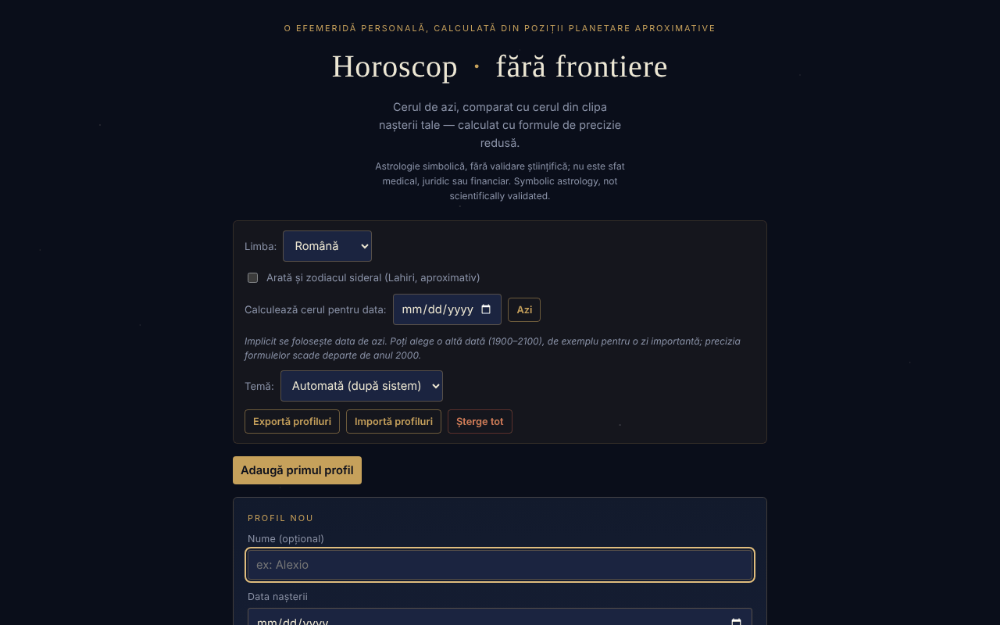

# Horoscop · fără frontiere

[English](README.md) · **Română** · [Français](README.fr.md) · [Italiano](README.it.md) · [Español](README.es.md) · [Português](README.pt.md) · [Deutsch](README.de.md) · [Magyar](README.hu.md)

**Versiune:** 1.3.7 · **Ultima actualizare:** 2026-10-22

Limbile interfeței: **Română, English, Français, Italiano, Español, Português (PT), Deutsch, Magyar**

O efemeridă personală, calculată local din poziții planetare aproximative (formule kepleriene de precizie redusă): cerul de azi, comparat cu cerul din clipa nașterii tale.

**Live:** https://chiuta.github.io/HoroScop/

## Ce este

Horoscop este o aplicație dintr-un singur fișier HTML care calculează în browser pozițiile Soarelui, Lunii și ale celor opt planete (elemente orbitale kepleriene, formule cu precizie redusă de tip Schlyter / Meeus), le compară cu tema natală a unui profil și compune o „citire" zilnică. Aplicația precizează în text că astrologia este tratată simbolic și că nu estimează riscuri de sănătate sau de mortalitate.

## Funcții

- Profiluri multiple (nume opțional, data, ora și fusul orar UTC±, locul nașterii cu latitudine/longitudine pentru ascendent): „Adaugă", „Editează", „Duplică", „Șterge".
- Citirea zilei pe secțiuni: Panorama, Suflet & relații, Muncă & bani, Trup & energie, Sfatul zilei; „Copiază citirea de azi".
- „Cerul de azi", „Săptămâna care vine" (cel mai puternic aspect pe zi), elemente de azi, retrograde, Luna goală de curs, eclipse posibile, cazimi / combust.
- Tema natală, structura temei, aspecte natale semnificative, rozeta aspectelor, orrery natal 3D (rotire prin tragere).
- Revoluții solare (de la naștere până azi și proiecție înainte), întoarceri Saturn / Jupiter / Lună.
- Compatibilitate (sinastrie) simplificată între două profile.
- „Muzica sferelor": fiecare planetă natală devine un ton („▶ Cântă tema ta" / „■ Oprește").
- „Portret cosmic": videoclip de aproximativ 6 secunde generat local, descărcabil ca `portret-cosmic.webm`.
- Opțiune pentru zodiacul sideral (Lahiri, aproximativ).
- „Calculează cerul pentru data”: alegi o altă dată (1900–2100, ora 12:00 locală) și toate secțiunile (cerul, aspectele, săptămâna, citirea, copierea) se calculează pentru acea zi; „Azi” revine. Data aleasă nu se păstrează între sesiuni.
- Temă: automată (după preferința sistemului), întunecată sau luminoasă; alegerea se păstrează local.
- Secțiune „Cum se calculează asta" cu precizia estimată și limitele (nu sunt calculate casele astrologice, doar ascendentul).

## Funcții noi (1.1.0)

Cardul pliabil **„Efemeride locale (FFF.ephem)”**, la finalul paginii, calculează local (fără rețea), pentru un loc și pentru data aleasă în aplicație („Calculează cerul pentru data”; implicit azi):

- **Soare:** răsărit, trecere la meridian (cu altitudinea maximă), apus, durata zilei și crepusculele civil, nautic, astronomic.
- **Lună:** faza, iluminarea, vârsta, distanța, răsărit/apus și următoarele patru faze (lună nouă, primul pătrar, lună plină, ultimul pătrar).
- **Poziții** pentru Soare, Lună și cele opt planete (+ Pluto): longitudine ecliptică cu semn, altitudine/azimut (cu refracție), răsărit/apus, magnitudine, elongație.
- **Coloana „Δ”**: diferența, în minute de arc, dintre longitudinea din modelul simplu al aplicației (elemente kepleriene, cel care alimentează citirile) și cea din `FFF.ephem`. La 4 date de probă diferențele au fost: Soare ≤ 0,5′, planete ≤ 8′ (cele mai mari: Pluto, Uranus), Lună până la ≈ 20′. Cifrele arată cât de mult poate greși modelul simplu; citirile și aspectele **nu** au fost modificate.
- Locul: lat/lon, nume din lista de orașe a aplicației, profilul activ (locul nașterii) sau **GPS cu consimțământ în două trepte** (confirmare în pagină, apoi o singură cerere; nu se salvează). Fusul orar se completează cu cel al browserului și se poate edita (nume IANA).
- Precizia declarată apare în card (secțiunea „Precizie”) și mai jos.

Cardul este numai în limba română (textele de interpretare nu sunt traduse; restul aplicației este disponibil în 8 limbi), și se ascunde la imprimare.

## Manual de utilizare

1. Apasă „Adaugă primul profil" (sau „Adaugă").
2. Completează data nașterii; opțional numele, ora, fusul orar UTC± (România: +2 iarna, +3 vara) și latitudinea/longitudinea locului. Fără oră, ascendentul nu poate fi calculat.
3. Apasă „Salvează profilul" (sau „Renunță").
4. Citește secțiunile zilei; „↻ Actualizează acum" recalculează cerul.
5. Bifează opțiunea pentru zodiac sideral dacă dorești; din „Calculează cerul pentru data” poți vedea cerul într-o altă zi; din „Temă” alegi aspectul.
6. Pentru muzică apasă „▶ Cântă tema ta"; pentru video „🎬 Generează portretul", apoi descarcă fișierul.
7. „Exportă profiluri" salvează profilurile într-un fișier; „Importă profiluri" le reîncarcă; „Șterge tot" le elimină. Tasta Escape închide formularul de profil (dacă există alte profiluri).

## Confidențialitate și rețea

- Local: profilurile se păstrează în `localStorage` (`horoscopFF_profiles_v1`, profilul activ `horoscopFF_active_v1`, opțiunea sideral `horoscopFF_sidereal_v1`, tema `horoscopFF_theme_v1`). Dacă stocarea nu este disponibilă (mod privat), aplicația afișează un avertisment și profilurile nu se păstrează fără export.
- Rețea: în codul verificat nu există apeluri `fetch`, scripturi sau resurse externe; calculele se fac în browser.
- Interfața are 8 limbi (RO, EN, FR, IT, ES, PT, DE, HU); textele lungi de interpretare rămân în română. Traducerile automate fr/it/es/pt/hu/de (interfață și kit) nu sunt verificate nativ.

- 1.1.0: **geolocația** (`navigator.geolocation`) se folosește doar dacă apeși „Folosește locația mea (GPS)” din cardul de efemeride și confirmi în pagină. Nu există cereri de rețea noi și nu se salvează nimic nou în `localStorage` (cardul nu are stare persistentă). Kitul `fff-kit` (`core`, `label`, `bundle`, `ephem`) adaugă butonul de transparență și indexul `fff.horoscop.__keys` al cheilor deja existente.
## Avertisment

Conținut informativ, simbolic și de divertisment; nu înlocuiește sfatul medical, juridic sau financiar. Astrologia nu are validare științifică: pozițiile planetelor sunt calcule astronomice (cu precizie redusă, formule de tip Schlyter / Meeus), dar interpretările („citirile”) sunt tradiție culturală, nu predicții validate. Aceeași notă apare în subsolul aplicației.

## Limite (funcțiile noi)

- **Efemeride locale — precizie.** Împotriva modelului fizic de referință (JPL DE421/DE423) pozițiile aparente ale Soarelui și planetelor diferă cu ≤ 3″ (Neptun ≤ 5″, Pluto ≤ 7″), ale Lunii cu ≤ 1,5″; răsăritul/apusul Soarelui ≤ 6 s, ale Lunii ≤ 25 s; fazele ≤ 30 s. Față de pyephem 4.2.1 (test în `tests/`): răsărit/apus ≤ 0,5 s, faze ≤ 6 s, alt/az ≤ 0,003°. Orele sunt afișate rotunjit la minut. **În realitate** răsăritul/apusul diferă cu minute din cauza refracției reale, a reliefului și a altitudinii (nemodelate), iar ΔT e incert cu ≈ ±1 s în 2027. Magnitudinile sunt orientative. Nu e potrivit pentru navigație sau observații astrometrice.
- Restul aplicației (citiri, aspecte, teme natale) folosește în continuare modelul simplu cu precizie redusă; efemeridele noi nu îl înlocuiesc. Nu sunt calculate casele astrologice cu `FFF.ephem`.

## Teste

`node tests/fff-r8.test.mjs` (Playwright din `/opt/node-tools`, Chromium local, rețeaua blocată; `tests/_lib.mjs` are ajutoarele comune). Valorile de referință sunt în `tests/ref-c3a.json`: momentele de răsărit/apus/trecere (Soare, Lună; 5 locuri × 4 date), 56 de momente de fază și 54 de poziții alt/az, calculate independent cu **pyephem 4.2.1** (folosit doar offline pentru a genera numerele; nu face parte din aplicație). Fiecare test are pragul scris în cod; testul de accesibilitate (axe-core, `bypassCSP`) rulează și în dialoguri/panouri deschise, la 1280×800 și 360×740.

## Rulare locală / offline

Descarcă `index.html` și deschide-l în browser; nu are nevoie de internet în codul verificat.

## Licență

MIT — vezi fișierul `LICENSE`. © 2026 Alexandru-Ionuț Chiuță (Alexio). Eventualele biblioteci terțe incluse în fișier își păstrează licențele proprii.

Licență: MIT (vezi fișierul LICENSE). Contact: alexio@trom.tf

Aceeași declarație apare în antetul HTML și în subsolul aplicației. Textul licenței se află în fișierul LICENSE.

## Istoric / Changelog

### 1.3.7 — 2026-10-22

fff-kit 1.1.4: ținte tactile și text minim.

### 1.3.6 — 2026-10-22

fff-kit 1.1.2: PBKDF2 600 000 iterații, protecție anti-clickjacking.

### 1.3.5 — 2026-10-22
- Casetele confirm()/prompt() ale browserului înlocuite cu dialoguri proprii, traduse în cele 8 limbi (ștergerea profilului, ștergerea tuturor datelor (doi pași), copierea manuală); căsuța pentru zodiacul sideral de 24 px; eticheta „eyebrow” la 12 px.

### 1.3.4 — 2026-10-22
- Footer: removed duplicated license and disclaimer lines (Romanian).

### 1.3.3 — 2026-10-22
- Fix de traducere: descrierea (și numele) din panoul de transparență urmează acum limba interfeței. Aria-label-ul rozetei aspectelor este tradus, iar liniile de subsol rămase în engleză în interfața română sunt acum în română.

### 1.3.2 — 2026-10-22
- Corecție de traducere: starea „niciun profil salvat” se actualizează imediat la schimbarea limbii cât timp formularul de profil e deschis; README-ul românesc nu mai conține rânduri în engleză.

### 19 octombrie 2026 (v1.2.0)
- Nou: „↗ Cerul nașterii tale, în TerRa” (doar cu oră și loc); avertisment de istoric; loc rotunjit la ~1 km; numele nu se trimite.

### 1.1.0 — 2026-10-14
- Nou: cardul „Efemeride locale (FFF.ephem)” (răsărit/apus/trecere, crepuscule, faze ale Lunii, poziții alt/az, coloana Δ față de modelul simplu, GPS cu consimțământ în două trepte, precizie declarată); kitul `fff-kit` (`core`, `label`, `bundle`, `ephem`); `tests/fff-r8.test.mjs` (47 de verificări, inclusiv axe în tema luminoasă și cea întunecată, la 1280×800 și 360×740). Comparație înainte/după la 1280×800: pagina inițială identică pixel cu pixel (cardul e închis implicit), deci captura de ecran nu s-a schimbat.

- 1.0.0 — 2026-10-12: versiunea și data ultimei actualizări sunt afișate în aplicație (prima versiune numerotată; în subsol, în locul vechii mențiuni „actualizat 11 octombrie 2026”).

Runda 7:
- **Verificare numerică documentată** (formulele nu au fost modificate): Soarele la 13.10.1992 0h TD → 199,902° față de 199,906° (Meeus, *Astronomical Algorithms*, ex. 25.a, metoda precisă, valoare reconfirmată prin pymeeus); Luna la 12.04.1992 0h TD → 133,221° față de 133,163° (ex. 47.a; diferență 0,06°); GMST la 10.04.1987 0h UT coincide cu exemplul Meeus 12.a (197,6932°); echinocțiul din 20.03.2026, 14:46 UTC → longitudine solară 0,004°. Ascendentul a fost comparat pe 60 de combinații aleatorii (ani 1900–2099, latitudini ±70°, orice longitudine) cu o metodă numerică independentă — diferență maximă sub 0,03°. Rezumatul apare în secțiunea „Cum se calculează asta”. Momentele sunt tratate ca UTC (fără ΔT ≈ 1 minut).
- Hash-ul CSP recalculat; axe-core = 0 violări la 1280 și 360 px.

Runda 6:
- Nou: „Calculează cerul pentru data” (1900–2100) și alegerea temei (automată / întunecată / luminoasă, cu paletă luminoasă și suport pentru `prefers-color-scheme`). Textele „azi” se adaptează când e aleasă altă dată. Hash-ul CSP recalculat; captura de ecran reîmprospătată.
- Sinastria: cât timp nu e ales niciun profil, cardul afișează acum „Alege un profil din listă pentru a vedea compatibilitatea.”, în loc să rămână gol.
- Accesibilitate: conținutul paginii este acum într-un `<main>` (înainte exista doar când graficul era vizibil); cele două liste derulabile de revoluții solare au etichete distincte; axe-core = 0 violări, cu și fără profil, la 1280 și 360 px.
- Politica CSP leagă acum scriptul prin hash (înainte `'unsafe-inline'`).
- Calculele astronomice sunt dinamice (data curentă); formulele nu au fost modificate.

## Autor

Alexio — Alexandru-Ionuț Chiuță, contact: alexio@trom.tf

## Rezumat

Horoscop · fără frontiere este o efemeridă personală într-un singur fișier, în limba română: calculează pozițiile planetare în browser, compară cerul de azi cu o hartă natală și afișează interpretări zilnice, aspecte, reveniri solare, sinastrie, un orrery natal 3D, muzică pe tonurile planetelor și un portret WebM descărcabil. Profilurile se păstrează în localStorage, cu export/import JSON. Nu s-au găsit cereri de rețea în cod. Licență: MIT (vezi fișierul LICENSE) (contact: alexio@trom.tf).

## Audit

Audit: 2026-10-10 (rundă 2, 2026-10-11: sloganul „comparat exact” / „poziții reale” reformulat pentru consecvență cu secțiunea de metodologie — precizie redusă, semnul poate diferi cu o zi la cuspide) — verificat: 0 erori JS, fără cereri de rețea (CSP `default-src 'none'; connect-src 'none'`), numele de profil nu produce XSS (testat cu markup în nume și loc). Corectat contrastul din subsol, lista derulabilă a revoluțiilor solare (acum accesibilă cu tastatura) și adăugat avertismentul de mai sus.

Runda 3 (2026-10-11): declarație explicită de licență nedeclarată (antet, subsol, README) și notă de avertisment astrologic vizibilă sub titlu, în RO și EN.
